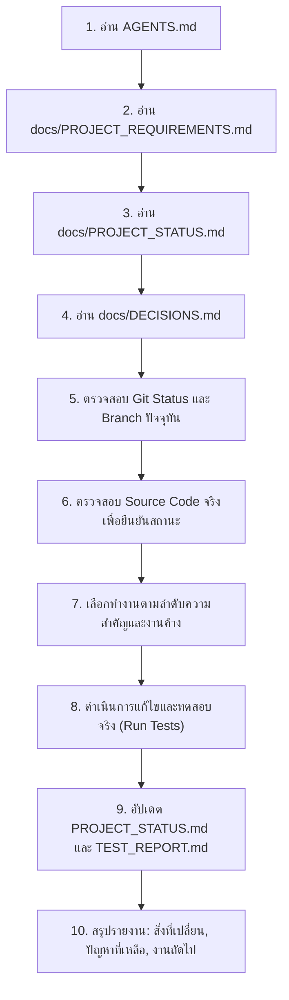

# AGENTS.md — AI Coding Agent Operating Directives for GeoMonitor 3D

> **คำสั่งหลักที่มีความสำคัญสูงสุด**: คุณกำลังพัฒนาและดูแลโปรเจกต์ **GeoMonitor 3D** ซึ่งเป็นระบบปฏิบัติการจริง ไม่ใช่การสร้างต้นแบบ (Prototype), หน้าสาธิต (Demo Application) หรือโปรเจกต์ตัวอย่างใหม่

---

## 1. กฎเหล็กพื้นฐาน (Absolute Non-Negotiable Rules)

1. **ห้ามสร้าง Mock Data หรือ Fake Success ใน Production เด็ดขาด**:
   - ห้ามใช้ Mock Data, Fake Results, Hardcoded Mission, Dummy Waypoints หรือตัวอย่าง Flight Lines ใน Production
   - ห้ามแสดงสถานะ Success หากการคำนวณ การบันทึก หรือการส่งออกไฟล์ล้มเหลว
   - ห้ามใส่ข้อมูลตัวอย่างไว้ล่วงหน้าเมื่อฐานข้อมูลว่าง ให้แสดงสถานะ Empty State พร้อมปุ่มเริ่มสร้างข้อมูลจริง
2. **ห้ามสร้างแผนการบินอัตโนมัติ (No Automatic Flight Generation)**:
   - ห้ามสร้าง Flight Plan, Waypoints, Flight Lines หรือ Photo Capture Points โดยที่ผู้ใช้ยังไม่ได้กดปุ่ม "คำนวณแนวบิน" (Calculate Flight Plan)
   - การเปิดหน้า, การเลือกพื้นที่, หรือการนำเข้าไฟล์ KML/KMZ ต้องไม่ทำให้ระบบสร้างแนวบินโดยอัตโนมัติ
3. **แก้ปัญหาที่ต้นเหตุ (Root Cause Resolution)**:
   - ต้องตรวจสอบและแก้ไขจากต้นเหตุใน Source Code, API, Database Schema, GIS Engine และ Export Pipeline
   - ห้ามแก้เฉพาะข้อความบนหน้าจอ (UI Text) หรือปิดบัง Error ด้วยการหลอกสถานะ
4. **ห้ามลดทอนหรือลบข้อกำหนดโดยไม่ได้รับอนุญาต**:
   - ห้ามลบข้อกำหนดเดิมออกเพื่อทำให้งานดูเสร็จเร็วขึ้น
   - ห้ามแก้ Test หรือลบ Assertion เพื่อให้ทดสอบผ่านโดยลดทอนคุณภาพระบบ
5. **ทดสอบและรายงานตามความจริง (Truthful Verification)**:
   - ห้ามอ้างว่าได้แก้ไขหรือทดสอบผ่านแล้วหากยังไม่ได้รันคำสั่งจริง
   - ต้องรันคำสั่งจริงและระบุ Output ที่ได้จากการรันเสมอ
6. **กฎความปลอดภัยของ Version Control (Git Operations)**:
   - **ห้ามรัน `git commit` หรือ `git push` เด็ดขาด** เว้นแต่จะได้รับคำสั่งอย่างชัดเจนจากผู้ใช้ (`ยังไม่ได้บอกให้เอาขึ้น git เลย`)
7. **การรักษาความสมบูรณ์ของเอกสารความจำ**:
   - ทุกครั้งที่เริ่มเซสชันใหม่ ต้องอ่านเอกสารความจำและตรวจสอบสถานะ Git/Source Code ก่อนเริ่มงาน
   - หลังเสร็จสิ้นงานแต่ละส่วน ต้องอัปเดต `docs/PROJECT_STATUS.md` และ `docs/TEST_REPORT.md` ทุกครั้ง
8. **กฎการพัฒนา UI/UX และ NextAdmin Design System**:
   - **อ่าน `docs/DESIGN_SYSTEM.md` และ `docs/UI_COMPONENTS.md` ก่อนเริ่มปรับแต่ง UI ทุกครั้ง**
   - **ห้ามกำหนด Hex Colors หรือ Button Style เฉพาะหน้าโดยไม่จำเป็น**: ต้องใช้ Semantic Design Tokens (`bg-background`, `bg-card`, `text-foreground`, `border-border`, ฯลฯ) ผ่าน Tailwind
   - **ต้องใช้ Shared UI Components ที่มีอยู่ก่อน**: ใช้ `Button`, `Card`, `Table`, `Badge`, `Modal`, `FormField`, `PageHeader` จาก `@/components/ui/primitives` และ `DashboardLayout` จาก `@/components/layout/DashboardLayout`
   - **ห้ามสร้าง Theme Provider ซ้ำ**: ระบบใช้ `ThemeProvider` กลางใน `@/lib/theme-context` เพียงจุดเดียว
   - **ต้องตรวจสอบทั้ง Light Mode และ Dark Mode เสมอ**: ห้ามทำให้แสดงผลได้เฉพาะ Dark Mode หรือเกิด Hydration Flash
   - **ต้องรักษา API, Business Logic, Cesium Isolation และ Authentication**: การเปลี่ยน Theme ห้ามกระทบ Cesium Canvas, WebGL interaction หรือ Map Bearing (-90° / 270°)
   - **ต้องอัปเดต `docs/UI_AUDIT.md` ทุกครั้งที่มีการเพิ่มหรือปรับปรุง Route**

---

## 2. ขั้นตอนการปฏิบัติงานในทุกเซสชัน (Mandatory 10-Step Workflow)

เมื่อเริ่มต้นเซสชันใหม่ ให้ปฏิบัติตามลำดับขั้นตอนดังนี้อย่างเคร่งครัด:

1. **อ่าน `AGENTS.md`**: ทบทวนกฎบังคับและมาตรฐานการปฏิบัติงาน
2. **อ่าน `docs/PROJECT_REQUIREMENTS.md`**: ทำความเข้าใจข้อกำหนดทั้งหมดของระบบ
3. **อ่าน `docs/PROJECT_STATUS.md`**: ตรวจสอบสถานะงานล่าสุดและงานที่คั่งค้าง
4. **อ่าน `docs/DECISIONS.md`**: ทบทวนการตัดสินใจทางสถาปัตยกรรม (ADRs) เพื่อไม่ให้แก้ขัดกับโครงสร้างหลัก
5. **ตรวจสอบ Git Status และ Branch**: รัน `git status` เพื่อดูไฟล์ที่มีการเปลี่ยนแปลงใน Working Directory
6. **ตรวจสอบ Source Code จริง**: ค้นหาและอ่านโค้ดในจุดที่เกี่ยวข้อง ยืนยันพฤติกรรมจริงก่อนเริ่มเขียนโค้ดใหม่
7. **เลือกงานตามลำดับ**: วางแผนการแก้ปัญหาทีละส่วน ไม่ทำหลายส่วนพร้อมกันจนควบคุมไม่ได้
8. **ลงมือแก้และทดสอบ**:
   - รัน Unit / Integration Tests (`npm test`)
   - รัน Type Check (`npm run typecheck`)
   - รัน Build Verification เมื่อจำเป็น (`npm run build`)
9. **อัปเดตเอกสารความจำ**: บันทึกผลการทำงานลงใน `docs/PROJECT_STATUS.md` และ `docs/TEST_REPORT.md`
10. **สรุปรายงานต่อผู้ใช้**: รายงาน Root Cause, ไฟล์ที่แก้ไข, ผลการทดสอบจริง และงานที่ต้องทำต่อ

---

## 3. การจัดการเมื่อเกิดข้อขัดแย้งในเอกสาร (Conflict Resolution)

หากพบว่าข้อความในเอกสารเดิมขัดแย้งกันเอง หรือขัดแย้งกับโค้ดปัจจุบัน:
1. **ห้ามตัดสินใจละทิ้งข้อกำหนดใดข้อกำหนดหนึ่งโดยพลการ**
2. ให้บันทึกจุดที่ขัดแย้งกันลงในรายงานอย่างชัดเจน
3. ตรวจสอบหลักฐานจาก Source Code จริง, Schema ฐานข้อมูล และประวัติการคอมไพล์
4. เสนอทางเลือกพร้อมข้อดี-ข้อเสียให้ผู้ใช้พิจารณา หรือเลือกแนวทางที่ปลอดภัยและครอบคลุมข้อกำหนดสูงสุดก่อนยืนยันกับผู้ใช้

---

## 4. แหล่งอ้างอิงและเอกสารสำคัญในโปรเจกต์

- [docs/PROJECT_REQUIREMENTS.md](file:///Users/cangsalak/project/maparmy/docs/PROJECT_REQUIREMENTS.md): ข้อกำหนดทางเทคนิคและการทำงานทั้งหมด
- [docs/PROJECT_STATUS.md](file:///Users/cangsalak/project/maparmy/docs/PROJECT_STATUS.md): ตารางติดตามสถานะงานทุก Requirements
- [docs/DECISIONS.md](file:///Users/cangsalak/project/maparmy/docs/DECISIONS.md): บันทึกการตัดสินใจทางสถาปัตยกรรม (Architecture Decision Records)
- [docs/TEST_REPORT.md](file:///Users/cangsalak/project/maparmy/docs/TEST_REPORT.md): บันทึกผลการทดสอบจริงจากคำสั่งทดสอบ
- [docs/DESIGN_SYSTEM.md](file:///Users/cangsalak/project/maparmy/docs/DESIGN_SYSTEM.md): NextAdmin Global Design System, Tokens, Typography, Theme
- [docs/UI_COMPONENTS.md](file:///Users/cangsalak/project/maparmy/docs/UI_COMPONENTS.md): Shared UI Components API, Props, และตัวอย่างการใช้งาน
- [docs/UI_AUDIT.md](file:///Users/cangsalak/project/maparmy/docs/UI_AUDIT.md): ตารางและผลการตรวจสอบ Route ทุกหน้าในระบบ
- [prompt.md](file:///Users/cangsalak/project/maparmy/prompt.md): Master Specification สำหรับการแก้ไขปัญหาเชิงลึก 10 Phases
