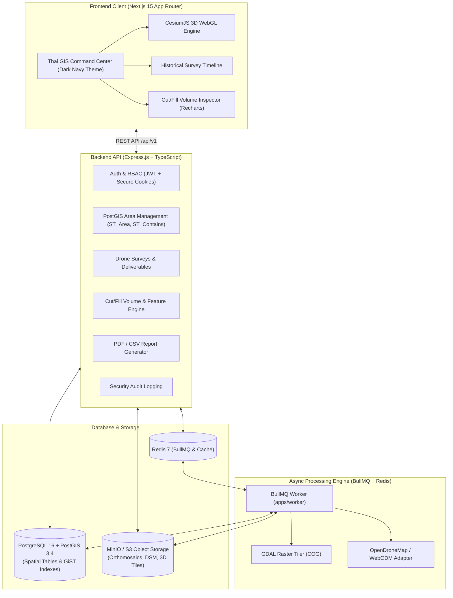

# GeoMonitor 3D — ระบบติดตามและวิเคราะห์การเปลี่ยนแปลงพื้นที่ 3 มิติจากภาพถ่ายโดรน
**Drone-Based Area Monitoring & 3D Geospatial Intelligence Platform**


---

## 1. ภาพรวมโครงการ (Project Overview)

**GeoMonitor 3D** คือแพลตฟอร์มภูมิสารสนเทศ 3 มิติระดับโปรดักชันสำหรับการติดตามพื้นที่ การนำเข้าข้อมูลการสำรวจจากอากาศยานไร้คนขับ (UAV/Drone), การแสดงผลแบบจำลองภูมิประเทศ 3 มิติ (3D Terrain), และการวิเคราะห์เปรียบเทียบการเปลี่ยนแปลงทางกายภาพข้ามช่วงเวลา

### คุณสมบัติหลัก (Key Capabilities):
1. **Interactive 3D GIS Command Center**: แสดงผลลูกโลกและภูมิประเทศ 3 มิติด้วย **CesiumJS** พร้อมการควบคุมมุมกล้อง การวัดระยะทางและพื้นที่แบบพิกัด geodesic
2. **PostGIS Spatial Architecture**: จัดเก็บและวิเคราะห์รูปแปลง Polygon/MultiPolygon ด้วยระบบพิกัดสากล **WGS84 (`EPSG:4326`)** และคำนวณขนาดพื้นที่แม่นยำด้วยการฉายพิกัด **UTM Zone 47N (`EPSG:32647`)**
3. **Historical Timeline & Before/After Swipe**: เส้นเวลาประวัติการบินสำรวจ พร้อมเครื่องมือสไลด์เปรียบเทียบภาพถ่ายออร์โธโมเสกแบบก่อน-หลัง (Split/Swipe Viewer)
4. **Change Detection (2 ระดับ)**:
   - **ระดับที่ 1 (Image Difference)**: ตรวจจับความต่างของสีและเนื้อภาพถ่ายออร์โธโมเสก
   - **ระดับที่ 2 (Elevation Comparison)**: คำนวณความต่างของระดับความสูง $\Delta Z = Z_{\text{comparison}} - Z_{\text{baseline}}$ และประเมินปริมาตรงานดินขุดถม (**Cut & Fill Volume** ในหน่วยลูกบาศก์เมตร $m^3$)
5. **Analyst Review Workflow**: ระบบการตรวจสอบยืนยันโดยนักวิเคราะห์ แยกแยะการเปลี่ยนแปลงจริงออกจากผลบวกลวง (False Positives) ที่เกิดจากเงา พืชพรรณ หรือมุมแสง
6. **Executive & Technical Reporting**: สร้างและส่งออกรายงานสรุปในรูปแบบ **PDF** และตารางสถิติ **CSV**
7. **Security & Audit Logs**: ระบบ Role-Based Access Control (**Admin, Project Manager, Analyst, Viewer**) พร้อมบันทึก Audit Trail แบบแก้ไขไม่ได้

---

## 2. สถาปัตยกรรมระบบ (System Architecture)



---

## 3. โครงสร้างโฟลเดอร์ Monorepo

```
maparmy/
├── apps/
│   ├── web/                         # Next.js 15 App Router (Thai UI, CesiumJS 3D)
│   │   ├── public/cesium/           # CesiumJS static assets (Workers, Assets, Widgets)
│   │   └── src/
│   │       ├── app/                 # Next.js pages: /, /map, /areas, /surveys, /analysis, /reports, /audit
│   │       ├── components/          # CesiumMap, Navbar, Sidebar, SurveyTimeline, AnalysisPanel
│   │       └── lib/                 # api client, auth-context, providers
│   │
│   ├── api/                         # Express.js REST API (/api/v1)
│   │   ├── src/
│   │   │   ├── config/              # Zod env validation
│   │   │   ├── db/                  # Drizzle ORM, PostgreSQL connection, migrations, seed
│   │   │   ├── middlewares/         # auth, RBAC, audit, errorHandler
│   │   │   ├── modules/             # auth, areas, surveys, change-analysis, reports, dashboard, audit
│   │   │   ├── swagger/             # OpenAPI 3.0 specification
│   │   │   └── app.ts               # Express bootstrap
│   │   └── tests/                   # Vitest unit & integration test suites
│   │
│   └── worker/                      # BullMQ asynchronous processing worker
│       └── src/index.ts             # Photogrammetry & COG tiling pipeline processor
│
├── packages/
│   └── shared/                      # Shared types, Zod schemas, spatial constants, Thai translations
│       └── src/                     # types, schemas (auth, area, survey, change, report), constants
│
├── infra/
│   └── docker/
│       ├── docker-compose.yml       # PostGIS 16-3.4 and Redis alpine services
│       └── init-db.sh               # PostGIS & UUID extension initialization
│
├── docs/
│   ├── ARCHITECTURE.md              # Master system architecture document
│   ├── DATABASE_ERD.md              # Database ER diagram & PostGIS DDL specifications
│   └── API_SPEC.md                  # REST API endpoint documentation
│
├── .env.example                     # Environment template
└── package.json                     # Monorepo workspaces config
```

---

## 4. บัญชีผู้ใช้เริ่มต้นสำหรับทดสอบ (Seed Test Accounts)

ทุกบัญชีใช้รหัสผ่าน: `Password123!`

| อีเมล (Email) | ชื่อ-นามสกุล | สิทธิ์ (Role) | การเข้าถึง |
|---|---|---|---|
| `admin@geomonitor.local` | พล.ท. ชาญชัย สุวรรณรัตน์ | `admin` | เข้าถึงทุกพื้นที่ จัดการผู้ใช้และ Audit Logs |
| `pm@geomonitor.local` | กิตติศักดิ์ รัตนวิบูลย์ | `project_manager` | จัดการโครงการ พื้นที่ และมอบหมายสมาชิก |
| `analyst@geomonitor.local` | ธีรภัทร วงศ์เจริญ | `analyst` | อัปโหลดไฟล์โดรน, ตรวจสอบและรับรองผล Cut/Fill |
| `viewer@geomonitor.local` | นภัสสร ศิริวัฒนา | `viewer` | ดูแผนที่ 3D, เส้นเวลา และส่งออกรายงาน |

---

## 5. พื้นที่และชุดข้อมูลสำรวจจำลอง (Demo Datasets)

1. **นิคมอุตสาหกรรมมาบตาพุด ระยะที่ 3 (Rayong MTP Phase 3)**:
   - โครงการถมทะเลและท่าเรือก๊าซ LNG ขนาด ~1.25 ตร.กม. (780 ไร่)
   - ข้อมูล 2 ช่วงเวลา: มกราคม 2026 (Baseline) และ มีนาคม 2026 (Comparison)
   - ปริมาตรงานดิน: **ขุดลอกแอ่งน้ำ (Cut)**: -120,500 ลบ.ม., **งานถมคันดิน (Fill)**: +85,400 ลบ.ม.
2. **เหมืองแม่เมาะ กฟผ. ลำปาง (Mae Moh Open-Pit Mine)**:
   - ติดตามการเปิดหน้าดินและการขุดเจาะถ่านหินลิกไนต์
3. **ท่าอากาศยานสุวรรณภูมิ ส่วนต่อขยาย (Suvarnabhumi Expansion)**:
   - ติดตามงานปรับระดับพื้นที่และก่อสร้างทางวิ่งเส้นที่ 3 (Runway 3)

---

## 6. วิธีการติดตั้งและรันระบบ (Setup & Running Guide)

### สิ่งที่จำเป็นต้องมีในเครื่อง (Prerequisites):
- Node.js v20 ขึ้นไป (แนะนำ v24)
- Docker Desktop (สำหรับ PostGIS และ Redis)

### ขั้นตอนการรัน:

1. **ติดตั้ง Dependencies ใน Monorepo**:
   ```bash
   npm install
   ```

2. **คอมไพล์ Shared Package**:
   ```bash
   npm run build --workspace=@geomonitor/shared
   ```

3. **สตาร์ทฐานข้อมูล PostGIS และ Redis ผ่าน Docker**:
   ```bash
   npm run docker:up
   ```

4. **รัน Migration และ Seed ข้อมูลภูมิสารสนเทศภาษาไทย**:
   ```bash
   npm run db:migrate --workspace=@geomonitor/api
   npm run db:seed --workspace=@geomonitor/api
   ```

5. **รันเซิร์ฟเวอร์ Backend API (Port 4000)**:
   ```bash
   npm run dev:api
   ```
   - Swagger Documentation: `http://localhost:4000/api-docs`
   - Health Check: `http://localhost:4000/api/v1/health`

6. **รันเซิร์ฟเวอร์ Frontend Next.js (Port 3000)**:
   ```bash
   npm run dev:web
   ```
   - เข้าสู่ระบบผ่านเบราว์เซอร์: `http://localhost:3000`
   - แผนที่ 3D Command Center: `http://localhost:3000/map`

7. **รัน Worker สำหรับประมวลผลพื้นหลัง (BullMQ)**:
   ```bash
   npm run dev:worker
   ```

---

## 7. การทดสอบอัตโนมัติ (Automated Tests)

รันชุดการทดสอบการเชื่อมต่อ PostGIS, การคำนวณพื้นที่เชิงพิกัด, การยืนยันสิทธิ์ RBAC, และ REST API:
```bash
npm run test --workspace=@geomonitor/api
```

ผลการทดสอบ:
```
 ✓ tests/health.test.ts (3 tests)
   ✓ should successfully connect to PostgreSQL with PostGIS extension
   ✓ should verify seeded Thai managed areas and spatial calculations
   ✓ should verify seeded test accounts exist with roles
 ✓ tests/api.test.ts (6 tests)
   ✓ GET /api/v1/auth/me should return current user profile
   ✓ GET /api/v1/areas should return list of managed areas with PostGIS GeoJSON
   ✓ POST /api/v1/areas should create new managed area with PostGIS polygon
   ✓ POST /api/v1/areas/:areaId/surveys should register a new drone survey
   ✓ POST /api/v1/surveys/:id/assets should register deliverable raster
   ✓ GET /api/v1/dashboard/metrics should return aggregated metrics from database
```

---

## 8. ความปลอดภัยและการปกป้องข้อมูล (Security Best Practices)
- ข้อมูลตำแหน่งรูปแปลงและผลลัพธ์การบินสำรวจถูกเข้ารหัสและตรวจสอบสิทธิ์ตามระดับองค์กร
- ป้องกันการเข้าถึงไฟล์โดยตรงผ่าน Presigned S3 URLs พร้อมจำกัดเวลาหมดอายุ
- รหัสผ่านเข้ารหัสด้วย bcrypt salt rounds 10
- ตรวจสอบรูปแบบและขนาดข้อมูลด้วย Zod ทุกจุดรับข้อมูล
- บันทึก Audit Log ทุกการกระทำที่สำคัญในตารางแบบแก้ไขไม่ได้
