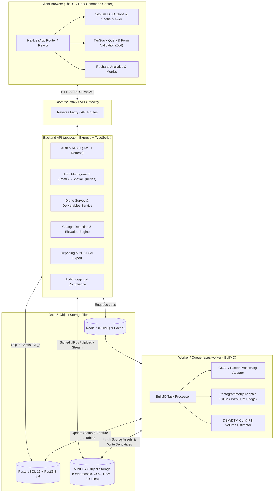

# GeoMonitor 3D — Architecture & Specification Document

**Project**: GeoMonitor 3D (ระบบติดตามและวิเคราะห์การเปลี่ยนแปลงพื้นที่ 3 มิติจากภาพถ่ายโดรน)  
**Version**: 1.0.0  
**Stack**: Next.js (App Router), CesiumJS, Tailwind CSS, Express.js (TypeScript), PostgreSQL + PostGIS, Drizzle ORM, MinIO (S3 compatible), Redis + BullMQ, GDAL.

---

## 1. System Architecture



---

## 2. Monorepo Folder Structure

```
maparmy/
├── apps/
│   ├── web/                         # Next.js App Router (Thai UI, CesiumJS, Dark Command Center)
│   ├── api/                         # Express.js REST API (/api/v1)
│   └── worker/                      # BullMQ asynchronous processing engine
├── packages/
│   ├── shared/                      # Shared types, Zod schemas, spatial constants
│   └── config/                      # Shared TS/ESLint config
├── infra/
│   ├── docker/                      # Docker Compose (PostGIS, MinIO, Redis)
│   └── scripts/                     # Seed data & spatial helpers
├── docs/                            # Technical Documentation
└── README.md                        # Documentation in Thai
```

---

## 3. Database Schema (PostgreSQL + PostGIS)

Key entities:
- `users`: User authentication, roles (`admin`, `project_manager`, `analyst`, `viewer`).
- `organizations`, `projects`: Tenant and project hierarchy.
- `managed_areas`: PostGIS geometry (`Polygon, 4326`), auto-calculated area in sqm (`ST_Area`).
- `area_members`: Explicit access assignment per user.
- `drone_surveys`: Survey flight metadata (date, altitude, GSD, sensor, CRS, processing status).
- `survey_assets`: Object storage references (Orthomosaic, DSM, DTM, COG, 3D Tiles).
- `processing_jobs`: BullMQ async job tracking.
- `change_analyses`: Level 1 & Level 2 comparison results (Cut/Fill volume, area).
- `change_features`: Vector change polygons with classification and confidence.
- `analyst_annotations`: Analyst verification (Confirmed, False Positive).
- `reports`: Generated reports with PDF/CSV download.
- `audit_logs`: Immutable compliance audit trail.

---

## 4. REST API Endpoints Contract (`/api/v1`)
- Auth: `/api/v1/auth/login`, `/api/v1/auth/refresh`, `/api/v1/auth/logout`, `/api/v1/auth/me`
- Areas: `/api/v1/areas` (CRUD with PostGIS GeoJSON)
- Surveys: `/api/v1/areas/:areaId/surveys`, `/api/v1/surveys/:id`, `/api/v1/surveys/:id/assets`
- Processing: `/api/v1/surveys/:id/process`, `/api/v1/jobs/:jobId`, `/api/v1/jobs/:jobId/logs`
- Change Detection: `/api/v1/areas/:areaId/change-analyses`, `/api/v1/change-analyses/:id/features`, `/api/v1/change-features/:id/review`
- Reports: `/api/v1/reports`, `/api/v1/reports/:id/download`
- Audit & Metrics: `/api/v1/audit/logs`, `/api/v1/dashboard/metrics`

---

## 5. Phased Implementation Roadmap
- **Phase 1**: Monorepo setup, Docker Compose (PostGIS, MinIO, Redis), Shared Package, Express API scaffold with Health Check & OpenAPI.
- **Phase 2**: Auth (JWT + RBAC), Area Management with PostGIS spatial queries, Seed data for Thai sites.
- **Phase 3**: Next.js 3D Command Center with CesiumJS, dark GIS theme, Thai UI.
- **Phase 4**: Drone survey deliverables management, MinIO S3 object storage upload.
- **Phase 5**: Historical timeline slider and split/swipe before-and-after visualizer.
- **Phase 6**: Asynchronous BullMQ worker for Level 1 (Image) and Level 2 (Elevation Cut/Fill) change detection.
- **Phase 7**: Reports (PDF/CSV), Audit logging, Security tests & validation.
- **Phase 8**: Thai README and system verification.
