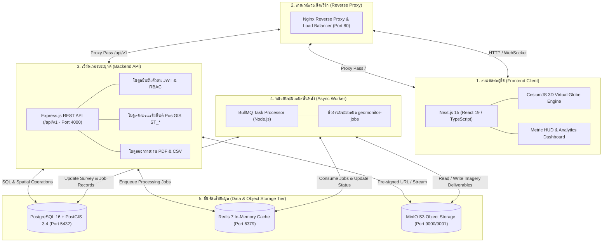

# 00-overview.md — ภาพรวมและความสามารถของระบบ GeoMonitor 3D

## วัตถุประสงค์
เอกสารฉบับนี้อธิบายภาพรวม สถาปัตยกรรมระดับสูง และขอบเขตความสามารถของระบบ **GeoMonitor 3D** ซึ่งเป็นแพลตฟอร์มภูมิสารสนเทศ 3 มิติ (3D Geospatial Monitoring Platform) สำหรับติดตามการเปลี่ยนแปลงทางกายภาพ การขุดดิน ถมดิน และความก้าวหน้าของพื้นที่โครงการจากภาพถ่ายทางอากาศและข้อมูลสำรวจด้วยอากาศยานไร้คนขับ (UAV / Drone) บนโครงสร้างพื้นฐานภายในองค์กร (On-Premises / Air-Gapped Network)

---

## สิ่งที่ต้องเตรียม
- ความเข้าใจเบื้องต้นเกี่ยวกับงานสำรวจทางอากาศและระบบสารสนเทศภูมิศาสตร์ (GIS)
- บัญชีผู้ใช้งานระบบและสิทธิ์การเข้าถึง (RBAC) ตามบทบาทหน้าที่
- เว็บบราวเซอร์ที่รองรับ WebGL 2.0 (Google Chrome, Microsoft Edge, Mozilla Firefox, Safari)

---

## ภาพรวมสถาปัตยกรรมระบบ (System Architecture)

ระบบ GeoMonitor 3D ถูกออกแบบตามมาตรฐาน Enterprise Full-Stack Microservices Architecture โดยประกอบด้วย 5 ชั้นบริการหลัก:

---

## ตารางสรุปขีดความสามารถหลักของระบบ (Core Capabilities)

| ความสามารถ | รายละเอียดเชิงเทคนิค | สถานะในระบบปัจจุบัน |
|---|---|---|
| **การจัดการโครงการและโฟลเดอร์ (Projects)** | จัดกลุ่มพื้นที่ดูแลตามสัญญาหรือภารกิจ พร้อมสรุปจำนวนแปลง | ✅ พร้อมใช้งานจริง (`/projects`) |
| **การจัดการพื้นที่รับผิดชอบ (Managed Areas)** | สร้างและวาดขอบเขตแปลงด้วย PostGIS GeoJSON Linear Ring และคำนวณเนื้อที่จริงเป็น ตารางเมตร/ไร่ ด้วย `ST_Area` บน EPSG:32647 | ✅ พร้อมใช้งานจริง (`/areas`) |
| **การลงทะเบียนรอบบินสำรวจ (Drone Surveys)** | บันทึกรหัสรอบบิน วันที่สำรวจ ข้อมูลโมเดลโดรน เซนเซอร์ ความสูงบิน (Flight Altitude) และ GSD | ✅ พร้อมใช้งานจริง (`/surveys`) |
| **การจัดการไฟล์ผลลัพธ์การสำรวจ (Deliverables)** | อัปโหลดและลงทะเบียนไฟล์ Orthomosaic, DSM, DTM, 3D Mesh, Point Cloud และ COG พร้อมค่า Hash SHA-256 | ✅ พร้อมใช้งานจริง (`/surveys`) |
| **การแสดงผลแผนที่ 3 มิติ (CesiumJS 3D Globe)** | Virtual Globe แสดงผลชั้นข้อมูลภูมิประเทศ (Terrain), ภาพถ่ายดาวเทียม, เวกเตอร์ขอบเขตแปลง และแถบเครื่องมือวัดระยะ/พื้นที่ | ✅ พร้อมใช้งานจริง (`/`) |
| **การเปรียบเทียบภาพก่อน-หลัง (Swipe Comparison)** | เครื่องมือสไลด์ผ่าภาพแบบเรียลไทม์ (Before/After Swipe Slider) สำหรับเปรียบเทียบการเปลี่ยนแปลงเชิงสายตา | ✅ พร้อมใช้งานจริง (`/`) |
| **การตรวจจับความเปลี่ยนแปลง (Change Detection)** | วิเคราะห์เปรียบเทียบความสูง DSM (Elevation Difference Grid) และคำนวณปริมาตรขุดดิน (Cut) / ถมดิน (Fill) | ✅ พร้อมใช้งานจริง (`/analysis`) |
| **การตรวจสอบและรับรองผล (Analyst Review)** | นักวิเคราะห์สามารถตรวจสอบรูปแปลงความเปลี่ยนแปลง พร้อมระบุสถานะ ยืนยัน (Confirmed) หรือ ความคลาดเคลื่อนจากเงา (False Positive) | ✅ พร้อมใช้งานจริง (`/analysis`, `/`) |
| **การออกรายงานทางการ (Official GIS Reports)** | ส่งออกรายงานสรุปปริมาตรงานดินในรูปแบบตารางข้อมูล CSV (UTF-8 BOM สำหรับ Excel) และเอกสาร PDF สำหรับพิมพ์ | ✅ พร้อมใช้งานจริง (`/reports`) |
| **ระบบบันทึกประวัติด้านความปลอดภัย (Security Audit Trail)** | บันทึกกิจกรรมสำคัญแบบลบไม่ได้ (Immutable Log) ระบุ IP Address, User Agent และช่วงเวลาตามเวลาท้องถิ่น | ✅ พร้อมใช้งานจริง (`/audit`) |
| **การประมวลผลภาพดิบเต็มรูปแบบ (Photogrammetry Engine)** | การประมวลผลโครงสร้างภาพจากชุดภาพดิบ UAV (Raw Imagery) ด้วย OpenDroneMap (ODM) / WebODM Engine | ⚠️ ต้องตั้งค่าเพิ่มเติม (เชื่อมต่อ NodeODM ภายนอก) |

---

## บทบาทและสิทธิ์ผู้ใช้งาน (Role-Based Access Control - RBAC)

ระบบ GeoMonitor 3D กำหนดระดับสิทธิ์การเข้าใช้งานเป็น 4 ระดับ เพื่อความปลอดภัยตามมาตรฐานองค์กร:

1. **ผู้ดูแลระบบสูงสุด (System Administrator - `admin`)**:
   - บริหารจัดการบัญชีผู้ใช้ สิทธิ์ และหน่วยงาน
   - ลบหรือล้างข้อมูลการปฏิบัติการ (Operational Reset)
   - เข้าถึงบันทึกการตรวจสอบความปลอดภัย (Audit Logs) และโครงสร้างพื้นฐานระบบ
2. **ผู้จัดการโครงการ (Project Manager - `project_manager`)**:
   - สร้างและจัดการโครงการ (Projects) และพื้นที่รับผิดชอบ (Managed Areas)
   - มอบหมายนักวิเคราะห์และกำหนดนโยบายการบินสำรวจ
   - ตรวจสอบรายงานสรุปเชิงบริหาร (Executive Reports)
3. **นักวิเคราะห์ภาพถ่าย (Photogrammetry Analyst - `analyst`)**:
   - ลงทะเบียนรอบบินสำรวจและนำเข้าไฟล์ผลลัพธ์ (Assets)
   - สั่งรันการตรวจจับความเปลี่ยนแปลงและการคำนวณปริมาตรดินขุด-ถม
   - ตรวจสอบและรับรองความถูกต้องของรูปแปลง (Review Features) พร้อมบันทึกข้อคิดเห็น
   - สร้างและดาวน์โหลดรายงานการวิเคราะห์ (PDF / CSV)
4. **ผู้ตรวจดูข้อมูล (Read-Only Viewer - `viewer`)**:
   - ตรวจดูแผนที่ 3 มิติ สำรวจขอบเขตพื้นที่ และดูสถิติในแผงข้อมูล (Inspector)
   - ไม่สามารถแก้ไข สร้าง หรือลบข้อมูลใดๆ ในระบบได้

---

## ขั้นตอนถัดไป
เมื่อทำความเข้าใจภาพรวมและสถาปัตยกรรมระบบเรียบร้อยแล้ว ให้ศึกษาข้อกำหนดซอฟต์แวร์และฮาร์ดแวร์ใน [01-prerequisites.md](01-prerequisites.md)
