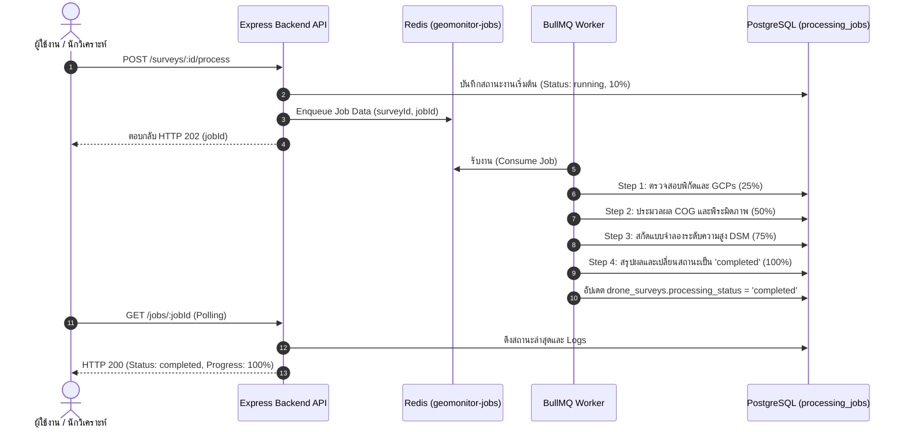

# 09-photogrammetry.md — การประมวลผล Photogrammetry และการติดตามสถานะงาน

## วัตถุประสงค์
เอกสารฉบับนี้อธิบายกระบวนการประมวลผลภาพถ่ายทางอากาศ (Photogrammetry Pipeline) การส่งงานเข้าสู่คิวประมวลผลพื้นหลัง (Background Job Queue) การติดตามความก้าวหน้า ตลอดจนคำแนะนำในการเชื่อมต่อกับเอนจินประมวลผลภายนอก เช่น OpenDroneMap (ODM) / WebODM

---

## สิ่งที่ต้องเตรียม
- ข้อมูลรอบบินสำรวจ (Drone Survey) ที่ลงทะเบียนไว้แล้ว
- บริการ Redis และ Background Worker (`apps/worker`) กำลังทำงาน
- ไฟล์ภาพผลลัพธ์การสำรวจ (Orthomosaic และ DSM GeoTIFF)

---

## สถานะการพัฒนาของเอนจินประมวลผลในระบบปัจจุบัน (Current Implementation Status)

> [!IMPORTANT]
> **ข้อชี้แจงสถานะระบบจริงในปัจจุบัน**:
> 1. **ในเวอร์ชันปัจจุบัน**: ระบบ GeoMonitor 3D มี Background Worker ที่พัฒนาด้วย **BullMQ และ Redis** (`apps/worker/src/index.ts`) รองรับการรับงานในคิว `geomonitor-jobs` ทำการตรวจสอบ Georeferencing, แปลงไฟล์เป็น Cloud Optimized GeoTIFF (COG), ตรวจสอบระดับความสูง และอัปเดตความก้าวหน้าลงในฐานข้อมูล
> 2. **การประมวลผลชุดภาพถ่ายดิบ (Raw UAV Images)**: ระบบยังไม่ได้ติดตั้ง OpenDroneMap (ODM) Engine ไว้ภายในคอนเทนเนอร์เดียวกันโดยตรง ดังนั้น หากหน่วยงานต้องการประมวลผลตั้งแต่ภาพถ่ายดิบจำนวนมาก (เช่น 500–2,000 ภาพ JPG) ขอแนะนำให้ประมวลผลผ่าน **WebODM Server** แยกต่างหาก แล้วนำส่งไฟล์ผลลัพธ์ Orthomosaic (`.tif`) และ DSM (`.tif`) เข้ามาลงทะเบียนใน GeoMonitor 3D

---

## ขั้นตอนการส่งงานเข้าสู่คิวประมวลผล (Dispatch Processing Job)

### 1. ผ่านหน้าจอจัดการข้อมูลโดรน (`/surveys`)
1. เข้าไปที่เมนู **"ข้อมูลโดรน"** (`http://localhost:3000/surveys`)
2. เลือกพื้นที่และรอบบินสำรวจที่ต้องการประมวลผล
3. คลิกปุ่ม **"เริ่มการประมวลผล (Start Processing)"**
4. ระบบจะส่งคำขอไปยัง API `POST /api/v1/surveys/:id/process`
5. แถบแสดงสถานะงาน (Processing Indicator Dock) จะปรากฏขึ้นที่มุมขวาล่างของหน้าจอ

---

## ตัวอย่างคำสั่งสั่งรันประมวลผลผ่าน REST API (cURL)

```bash
curl -X POST http://localhost:4000/api/v1/surveys/<SURVEY_ID>/process \
  -H "Content-Type: application/json" \
  -H "Authorization: Bearer <YOUR_ACCESS_TOKEN>" \
  -d '{
    "jobType": "photogrammetry_ingest",
    "parameters": {
      "dsmResolutionM": 0.05,
      "orthoResolutionM": 0.025,
      "generateCOG": true
    }
  }'
```

**ผลลัพธ์ที่ได้รับ (HTTP 202 Accepted):**
```json
{
  "success": true,
  "data": {
    "jobId": "b1a2c3d4-5e6f-7a8b-9c0d-1e2f3a4b5c6d",
    "status": "processing",
    "progress": 15,
    "message": "ส่งงานเข้าสู่คิวประมวลผลพื้นหลังเรียบร้อยแล้ว (Processing job enqueued)"
  }
}
```

---

## ลำดับขั้นตอนการทำงานของ Background Worker (Processing Pipeline)

เมื่อ Worker ดึงงานออกจากคิว Redis จะดำเนินการตามขั้นตอน 4 สเต็ป:



---

## การตรวจสอบความก้าวหน้าและบันทึกงาน (Job Polling & Logs)

### 1. เรียกดูสถานะงานผ่าน API
```bash
curl -s http://localhost:4000/api/v1/jobs/<JOB_ID> \
  -H "Authorization: Bearer <YOUR_ACCESS_TOKEN>" | jq .
```

**ผลลัพธ์ตัวอย่างเมื่อประมวลผลเสร็จสิ้น:**
```json
{
  "success": true,
  "data": {
    "id": "b1a2c3d4-5e6f-7a8b-9c0d-1e2f3a4b5c6d",
    "surveyId": "1a2b3c4d-5e6f-7a8b-9c0d-1e2f3a4b5c6d",
    "jobType": "photogrammetry_ingest",
    "status": "completed",
    "progressPercent": 100,
    "errorMessage": null,
    "logs": [
      { "timestamp": "2026-10-26T04:25:00.000Z", "message": "กำลังตรวจสอบข้อมูลตำแหน่งทางภูมิศาสตร์และ GCP...", "progress": 25 },
      { "timestamp": "2026-10-26T04:25:01.000Z", "message": "กำลังประมวลผล Cloud Optimized GeoTIFF (COG)...", "progress": 50 },
      { "timestamp": "2026-10-26T04:25:02.000Z", "message": "กำลังสร้างแบบจำลองระดับความสูงพื้นผิว (DSM)...", "progress": 75 },
      { "timestamp": "2026-10-26T04:25:03.000Z", "message": "การประมวลผลโมเดล 3 มิติเสร็จสมบูรณ์", "progress": 100 }
    ],
    "startedAt": "2026-10-26T04:24:59.000Z",
    "finishedAt": "2026-10-26T04:25:03.000Z"
  }
}
```

---

## แนวทางการตั้งค่าเชื่อมต่อกับ OpenDroneMap ภายนอก (External WebODM Setup)

หากหน่วยงานต้องการติดตั้งโหนดประมวลผลภาพดิบเต็มรูปแบบ:

1. ติดตั้ง WebODM บนเซิร์ฟเวอร์ที่มีการ์ดจอ NVIDIA GPU แยกต่างหาก:
   ```bash
   git clone https://github.com/OpenDroneMap/WebODM --config core.autocrlf=input --depth 1
   cd WebODM
   ./webodm.sh start
   ```
2. อัปโหลดภาพถ่ายโดรนดิบ (.JPG) และรันงานด้วยคำสั่ง SfM
3. ดาวน์โหลดไฟล์ผลลัพธ์ **Orthomosaic (GeoTIFF)** และ **DSM (GeoTIFF)**
4. นำไฟล์ดังกล่าวมาอัปโหลดเข้าสู่ GeoMonitor 3D ในหน้า `/surveys`

---

## ข้อผิดพลาดที่พบบ่อยและวิธีแก้ไข

### ข้อผิดพลาด: สถานะงานค้างอยู่ที่ `pending` หรือไม่มีความคืบหน้า
- **สาเหตุ**: Background Worker ไม่ได้รันอยู่ หรือ Redis หยุดการทำงาน
- **วิธีแก้ไข**: ตรวจสอบสถานะคอนเทนเนอร์ `geomonitor-worker` และ `geomonitor-redis` ด้วยคำสั่ง:
  ```bash
  docker ps | grep -E "worker|redis"
  docker logs geomonitor-worker
  ```

---

## ขั้นตอนถัดไป
เมื่อประมวลผลและลงทะเบียนเลเยอร์เรียบร้อยแล้ว ให้ศึกษาการเรียกดูและควบคุมแผนที่ 3 มิติใน [10-view-3d-map.md](10-view-3d-map.md)
