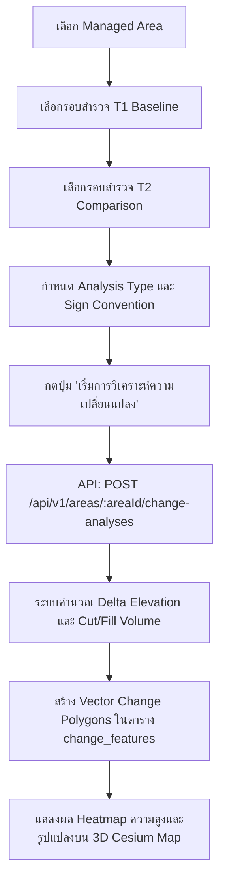

# 12. การเปรียบเทียบและตรวจจับความเปลี่ยนแปลง (Change Detection & Elevation Delta)

เอกสารนี้อธิบายขั้นตอนการรันกระบวนการตรวจจับความเปลี่ยนแปลงของพื้นผิวและสิ่งปลูกสร้างระหว่างรอบการบินสำรวจ 2 ช่วงเวลา ($T_1$ และ $T_2$) รวมถึงการคำนวณปริมาตรงานดินขุด-ถม (Cut & Fill Volume Calculation) ตามแบบจำลองความสูงเชิงเลข (DSM - Digital Surface Model)

---

## 1. วัตถุประสงค์
1. ประมวลผลเปรียบเทียบความแตกต่างเชิงพื้นที่ระหว่างรอบการสำรวจอ้างอิง (Baseline Survey: $T_1$) และรอบการสำรวจเปรียบเทียบ (Comparison Survey: $T_2$)
2. ตรวจจับการเปลี่ยนแปลงของพื้นผิว (2D Optical Orthomosaic Difference) และการเปลี่ยนแปลงทางแนวดิ่ง (3D Elevation Delta $\Delta Z = Z_{\text{comparison}} - Z_{\text{baseline}}$)
3. คำนวณปริมาตรงานดินขุด (Cut Volume, $m^3$) และงานดินถม (Fill Volume, $m^3$) พร้อมทั้งปริมาตรสุทธิ (Net Volume, $m^3$)
4. สกัดรูปแปลงเวกเตอร์ (Vector Polygons) ของพื้นที่ที่มีนัยสำคัญทางสถิติเพื่อส่งต่อให้นักวิเคราะห์ตรวจสอบ

---

## 2. สิ่งที่ต้องเตรียม
1. บัญชีผู้ใช้งานที่มีสิทธิ์ระดับ `admin`, `project_manager` หรือ `analyst` (ระดับ `viewer` ดูได้อย่างเดียว ไม่สามารถสั่งรันการวิเคราะห์ได้)
2. พื้นที่ดูแล (Managed Area) ที่มีรอบการสำรวจ (Drone Surveys) อย่างน้อย 2 รอบขึ้นไปในพื้นที่เดียวกัน
3. รอบการสำรวจทั้งสองต้องมีสถานะ `completed` และมีไฟล์ DSM/Orthomosaic พร้อมใช้งาน
4. พิกัดและระบบอ้างอิงพิกัด (CRS) ของทั้งสอง Survey ต้องสอดคล้องกัน (เช่น WGS 84 / UTM Zone 47N หรือ EPSG:4326)

---

## 3. ขั้นตอนการทำงานทีละข้อ



### ขั้นตอนผ่านหน้าเว็บ Web UI (`/analysis`)
1. เข้าสู่ระบบและเปิดไปที่เมนู **"วิเคราะห์การเปลี่ยนแปลง"** (`/analysis`) หรือเข้าจากเมนู **"พื้นที่รับผิดชอบ"** (`/areas`) แล้วคลิกปุ่ม **"วิเคราะห์ความเปลี่ยนแปลง"**
2. ในแผงควบคุม **"สร้างการวิเคราะห์ใหม่"**:
   - **พื้นที่รับผิดชอบ (Managed Area)**: เลือกพื้นที่เป้าหมาย
   - **การสำรวจอ้างอิง (Baseline $T_1$)**: เลือกรอบสำรวจช่วงเวลาแรก (เช่น การบินสำรวจก่อนเริ่มโครงการ)
   - **การสำรวจเปรียบเทียบ (Comparison $T_2$)**: เลือกรอบสำรวจช่วงเวลาที่สอง (เช่น การบินสำรวจประจำเดือนล่าสุด)
   - **ประเภทการวิเคราะห์ (Analysis Type)**:
     - `elevation_change`: วิเคราะห์การเปลี่ยนแปลงระดับความสูง 3D DSM (คำนวณปริมาตรขุด/ถม)
     - `surface_difference`: วิเคราะห์ความเปลี่ยนแปลงของพื้นผิว 2D Orthomosaic
     - `hybrid`: ผสานรวมทั้งภาพถ่ายและความสูง
   - **Sign Convention**: 
     - `cmp_minus_base` ($Z_{T_2} - Z_{T_1}$): กำหนดให้ค่าบวกคือถมดิน (Fill) และค่าลบคือขุดดิน (Cut) ตามมาตรฐานสากล
   - **หมายเหตุและข้อจำกัด (Limitations Notes)**: บันทึกสภาพหน้างาน เช่น ลมแรง หรือมุมแสงแดด
3. คลิกปุ่ม **"เริ่มการวิเคราะห์ (Run Analysis)"**
4. ระบบจะประมวลผลและสร้างบันทึกในตาราง `change_analyses` พร้อมสกัดโพลีกอน `change_features` แล้วนำทางไปยังหน้ารายละเอียดผลการวิเคราะห์

---

## 4. คำสั่ง Terminal ที่ต้องใช้จริง หากเกี่ยวข้อง

### ส่งคำสั่งรัน Change Detection ผ่าน REST API
```bash
# macOS / Linux
TOKEN="eyJhbGciOiJIUzI1NiIsInR5cCI6IkpXVCJ9..."
AREA_ID="67414bc5-1b4e-48f6-8c4d-9e6587c4f101"
BASE_SURVEY_ID="67414bc5-1b4e-48f6-8c4d-9e6587c4f201"
CMP_SURVEY_ID="67414bc5-1b4e-48f6-8c4d-9e6587c4f202"

curl -X POST "http://localhost:4000/api/v1/areas/${AREA_ID}/change-analyses" \
  -H "Authorization: Bearer ${TOKEN}" \
  -H "Content-Type: application/json" \
  -d '{
    "baselineSurveyId": "'"${BASE_SURVEY_ID}"'",
    "comparisonSurveyId": "'"${CMP_SURVEY_ID}"'",
    "analysisType": "elevation_change",
    "signConvention": "cmp_minus_base",
    "limitationsNotes": "การวิเคราะห์งานดินรอบประจำเดือนตุลาคม เปรียบเทียบกับฐานรากเดือนกันยายน"
  }'
```

```powershell
# Windows PowerShell
$Token = "eyJhbGciOiJIUzI1NiIsInR5cCI6IkpXVCJ9..."
$AreaId = "67414bc5-1b4e-48f6-8c4d-9e6587c4f101"
$BaseSurveyId = "67414bc5-1b4e-48f6-8c4d-9e6587c4f201"
$CmpSurveyId = "67414bc5-1b4e-48f6-8c4d-9e6587c4f202"

$Body = @{
    baselineSurveyId = $BaseSurveyId
    comparisonSurveyId = $CmpSurveyId
    analysisType = "elevation_change"
    signConvention = "cmp_minus_base"
    limitationsNotes = "การวิเคราะห์งานดินรอบประจำเดือนตุลาคม เปรียบเทียบกับฐานรากเดือนกันยายน"
} | ConvertTo-Json

Invoke-RestMethod -Uri "http://localhost:4000/api/v1/areas/$AreaId/change-analyses" `
  -Method Post `
  -Headers @{ "Authorization" = "Bearer $Token"; "Content-Type" = "application/json" } `
  -Body $Body
```

---

## 5. ตัวอย่างข้อมูลที่ถูกต้อง

### ข้อมูล Request Body (JSON)
```json
{
  "baselineSurveyId": "67414bc5-1b4e-48f6-8c4d-9e6587c4f201",
  "comparisonSurveyId": "67414bc5-1b4e-48f6-8c4d-9e6587c4f202",
  "analysisType": "elevation_change",
  "signConvention": "cmp_minus_base",
  "limitationsNotes": "วิเคราะห์ความเปลี่ยนแปลงระดับความสูงงานดิน ΔZ = Z_cmp - Z_base ความคลาดเคลื่อนแนวราบ ±0.03m แนวดิ่ง ±0.05m"
}
```

### โครงสร้างสูตรการคำนวณปริมาตรงานดิน (Cut / Fill Volume Math)
$$V_{\text{cell}} = \Delta Z_{i,j} \times A_{\text{cell}}$$
$$\text{Cut Volume } (V_{\text{cut}}) = \sum_{\Delta Z < -\epsilon} |\Delta Z_{i,j}| \times A_{\text{cell}}$$
$$\text{Fill Volume } (V_{\text{fill}}) = \sum_{\Delta Z > +\epsilon} \Delta Z_{i,j} \times A_{\text{cell}}$$
$$\text{Net Volume } (V_{\text{net}}) = V_{\text{fill}} - V_{\text{cut}}$$

*หมายเหตุ: ค่า $\epsilon$ (Threshold) มีค่าเริ่มต้นที่ $0.15\text{ m}$ เพื่อตัดสัญญาณรบกวน (Noise Filter) ของพื้นหญ้าและพืชคลุมดินขนาดเล็ก*

---

## 6. ผลลัพธ์ที่ควรเห็น

### ข้อมูล Response จาก API (HTTP 201 Created)
```json
{
  "success": true,
  "data": {
    "id": "78512cd6-2a5f-59e7-9d5e-0f7698d5a210",
    "areaId": "67414bc5-1b4e-48f6-8c4d-9e6587c4f101",
    "baselineSurveyId": "67414bc5-1b4e-48f6-8c4d-9e6587c4f201",
    "comparisonSurveyId": "67414bc5-1b4e-48f6-8c4d-9e6587c4f202",
    "analysisType": "elevation_change",
    "totalChangeAreaSqm": 40000,
    "cutVolumeM3": 83600,
    "fillVolumeM3": 52200,
    "netVolumeM3": -31400,
    "signConvention": "cmp_minus_base",
    "confidenceScore": 0.93,
    "status": "pending_review",
    "limitationsNotes": "วิเคราะห์ความเปลี่ยนแปลงระดับความสูงงานดิน ΔZ = Z_cmp - Z_base...",
    "createdAt": "2026-10-26T04:20:00.000Z"
  },
  "message": "ประมวลผลการวิเคราะห์การเปลี่ยนแปลงและคำนวณปริมาตรเรียบร้อยแล้ว"
}
```

### การแสดงผลบนหน้าจอ 3D Map
- **พื้นที่ขุดดิน (Earthwork Cut)**: ไฮไลต์ด้วยโพลีกอนสีแดงอมส้ม (`#ef4444`) พร้อมแสดงป้ายสถิติ เช่น ลดลงเฉลี่ย $-3.85\text{ m}$ ปริมาตร $83,600\text{ m}^3$
- **พื้นที่ถมดิน (Earthwork Fill)**: ไฮไลต์ด้วยโพลีกอนสีน้ำเงินอมฟ้า (`#3b82f6`) แสดงป้ายสถิติ เช่น สูงขึ้นเฉลี่ย $+2.90\text{ m}$ ปริมาตร $52,200\text{ m}^3$
- **Net Volume**: แสดงค่าปริมาตรสุทธิใน Inspector Panel ขวามือ (กรณีนี้เป็นลบ แสดงว่าขุดออกมากกว่าถมเข้า $31,400\text{ m}^3$)

---

## 7. วิธีตรวจสอบว่าทำสำเร็จ
1. ตรวจสอบตาราง `change_analyses` ในฐานข้อมูล PostgreSQL:
   ```sql
   SELECT id, analysis_type, total_change_area_sqm, cut_volume_m3, fill_volume_m3, net_volume_m3, status 
   FROM change_analyses 
   ORDER BY created_at DESC 
   LIMIT 1;
   ```
2. ตรวจสอบตารางรูปแปลงความเปลี่ยนแปลง `change_features`:
   ```sql
   SELECT feature_type, area_sqm, mean_elevation_change_m, estimated_volume_m3, is_confirmed
   FROM change_features
   WHERE change_analysis_id = '78512cd6-2a5f-59e7-9d5e-0f7698d5a210';
   ```
3. ตรวจสอบบันทึก Audit Log:
   ```sql
   SELECT action, resource_type, resource_id, created_at 
   FROM audit_logs 
   WHERE action = 'analysis.run' 
   ORDER BY created_at DESC 
   LIMIT 1;
   ```

---

## 8. ข้อผิดพลาดที่พบบ่อยและวิธีแก้ไข

| รหัสข้อผิดพลาด | สาเหตุที่เป็นไปได้ | แนวทางแก้ไข |
|---|---|---|
| `INVALID_SURVEYS` | เลือกรอบสำรวจ 2 รอบที่ไม่ได้อยู่ใน Managed Area เดียวกัน หรือเลือก Survey ซ้ำกัน | ตรวจสอบว่า `baselineSurveyId` และ `comparisonSurveyId` เป็น Survey คนละช่วงเวลาและอยู่ใน Area เดียวกัน |
| `SURVEYS_NOT_READY` | รอบสำรวจใดรอบหนึ่งยังประมวลผล photogrammetry ไม่เสร็จ (สถานะ `processing` หรือ `failed`) | รอให้ Worker ประมวลผล Survey ให้เสร็จสมบูรณ์ (`status: completed`) ก่อนเริ่มวิเคราะห์ |
| `INSUFFICIENT_OVERLAP` | พื้นที่ครอบคลุมของสองรอบการบินไม่ซ้อนทับกัน | วางแผนเส้นทางบินสำรวจโดรนให้ครอบคลุมขอบเขต Managed Area เดียวกัน |
| `CRS_MISMATCH` | ไฟล์ DSM ทั้งสองมีพิกัดอ้างอิงคนละระบบ และยังไม่ได้แปลงค่า (Reprojection) | ตรวจสอบว่าพิกัดแปลงเข้าสู่ EPSG:4326 หรือ EPSG:32647 เหมือนกัน |

---

## 9. ข้อควรระวังด้านความปลอดภัย
- การคำนวณปริมาตรงานดินมีผลต่องบประมาณโครงการและการบริหารสัญญา ผู้ใช้งานต้องระบุ `limitationsNotes` ทุกครั้งเพื่อบันทึกข้อจำกัดเชิงมาตรวิทยา (Metrology Limitations)
- ข้อมูลการวิเคราะห์จะถูกผูกเข้ากับ ID ผู้สั่งการ (`created_by`) และบันทึกลงใน `audit_logs` ป้องกันการปฏิเสธความรับผิดชอบ (Non-repudiation)
- ห้ามดัดแปลงแก้ไขค่า `cut_volume_m3` หรือ `fill_volume_m3` ในฐานข้อมูลโดยตรงโดยไม่ผ่านกระบวนการวิเคราะห์

---

## 10. ขั้นตอนถัดไป
เมื่อระบบสร้างรูปแปลงความเปลี่ยนแปลงเสร็จแล้ว ขั้นตอนต่อไปคือให้นักวิเคราะห์ทางภูมิสารสนเทศทำการตรวจสอบ คัดกรองผลบวกลวง (False Positives) และยืนยันผลการตรวจจับ ให้อ่านต่อที่ [13-review-results.md](file:///Users/cangsalak/project/maparmy/docs/user-guide/13-review-results.md)
