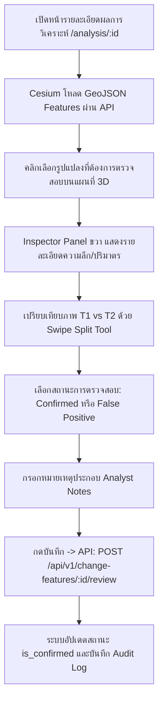

# 13. การตรวจสอบผลการวิเคราะห์ (Review & Analyst Annotations)

เอกสารนี้อธิบายขั้นตอนการตรวจสอบรูปแปลงความเปลี่ยนแปลง (Change Polygons Review) โดยนักวิเคราะห์ภูมิสารสนเทศ (GIS Analyst) เพื่อคัดกรองผลบวกลวง (False Positives) เช่น การเคลื่อนตัวของร่มเงา หรือการผลัดใบของพืชพันธุ์ธรรมชาติ พร้อมทั้งบันทึกการยืนยันและข้อคิดเห็นเชิงเทคนิค (Analyst Annotations) ลงในระบบ

---

## 1. วัตถุประสงค์
1. ตรวจสอบรูปแปลงความเปลี่ยนแปลงที่ระบบตรวจพบอัตโนมัติ (Candidate Change Features) ในแต่ละจุด
2. คัดแยกการเปลี่ยนแปลงจริง (Confirmed Change) ออกจากสิ่งรบกวนทางแสงและธรรมชาติ (False Positives)
3. ปรับปรุงสถานะ `is_confirmed` ของแต่ละรูปแปลง เพื่อให้การคำนวณปริมาตรและพื้นที่สรุปในรายงานมีความถูกต้องทางวิศวกรรม
4. บันทึกประวัติการตรวจสอบ (Audit Trail) พร้อมลายเซ็นดิจิทัลของผู้ตรวจ (Author ID) ลงในตาราง `analyst_annotations`

---

## 2. สิ่งที่ต้องเตรียม
1. บัญชีผู้ใช้งานที่มีสิทธิ์ระดับ `admin`, `project_manager` หรือ `analyst` (ระดับ `viewer` สามารถอ่านผลได้ แต่ไม่สามารถส่ง Review ได้)
2. ผลการวิเคราะห์การเปลี่ยนแปลงที่มีสถานะ `pending_review` หรือ `in_review`
3. ความรู้พื้นฐานในการจำแนกความแตกต่างระหว่างการขุด-ถมจริง กับความคลาดเคลื่อนจากร่มเงาเมฆ (Cloud Shadows) เงาตึก หรือยอดไม้ที่เคลื่อนไหวตามลม

---

## 3. ขั้นตอนการทำงานทีละข้อ



### ขั้นตอนผ่านหน้าเว็บ Web UI
1. เปิดหน้า **"การวิเคราะห์การเปลี่ยนแปลง"** (`/analysis`) แล้วคลิกเลือกผลการวิเคราะห์ที่ต้องการตรวจสอบ
2. ระบบจะโหลดแผนที่ Cesium 3D พร้อมรูปแปลงเวกเตอร์ทั้งหมดจาก API `GET /api/v1/change-analyses/:id/features`:
   - รูปแปลงขุดดิน (Cut) แสดงขอบเขตสีแดง
   - รูปแปลงถมดิน (Fill) แสดงขอบเขตสีน้ำเงิน
   - รูปแปลงที่ยังไม่ได้ตรวจสอบจะมีสถานะเป็น **"Candidate"**
3. **คลิกที่รูปแปลงเป้าหมาย**:
   - แถบ **Inspector Panel (แผงขวามือ)** จะเปิดขึ้นมา แสดงรหัสรูปแปลง (`Feature ID`), ชนิด (`featureType`), พื้นที่ (`areaSqm`), ความลึก/สูงเฉลี่ย (`meanElevationChangeM`), ปริมาตร (`estimatedVolumeM3`) และระดับความเชื่อมั่น (`confidence`)
4. **เปิดใช้แถบเลื่อนเปรียบเทียบ (Before/After Swipe)**:
   - เลื่อนแถบ Swipe ดูความแตกต่างระหว่างภาพออร์โธของ $T_1$ และ $T_2$ ณ บริเวณดังกล่าว เพื่อตรวจสอบว่ามีการก่อสร้าง/ขุดดินจริง หรือเป็นเพียงเงาตกกระทบ
5. **บันทึกผลการตรวจสอบ (Review Annotation)**:
   - เลือกผลการตัดสินจากรายการ:
     - `confirmed_change`: ยืนยันว่าเป็นการเปลี่ยนแปลงจริง (ระบบจะตั้งค่า `is_confirmed = true`)
     - `false_positive_shadow`: ปฏิเสธเนื่องจากเป็นเงาตกทอดของอาคารหรือเมฆ (`is_confirmed = false`)
     - `natural_vegetation`: ปฏิเสธเนื่องจากเป็นการเปลี่ยนแปลงของต้นไม้/หญ้าตามฤดูกาล (`is_confirmed = false`)
     - `sensor_noise`: ปฏิเสธเนื่องจากสัญญาณรบกวนของกล้องหรือมุมสะท้อนน้ำ (`is_confirmed = false`)
   - กรอก **"ข้อคิดเห็นของนักวิเคราะห์ (Analyst Notes)"** เช่น *"ยืนยันงานขุดบ่อบำบัดน้ำเสีย ลึกเฉลี่ย 3.8 เมตร ตรงกับแบบวิศวกรรม"*
6. คลิกปุ่ม **"บันทึกผลการตรวจสอบ (Save Review)"**
7. สัญลักษณ์รูปแปลงบนแผนที่จะเปลี่ยนไอคอนและสีเส้นขอบเพื่อระบุว่าได้รับการยืนยันแล้ว

---

## 4. คำสั่ง Terminal ที่ต้องใช้จริง หากเกี่ยวข้อง

### 1. เรียกดูรายการ Feature Collection ทั้งหมดของรอบการวิเคราะห์
```bash
# macOS / Linux
TOKEN="eyJhbGciOiJIUzI1NiIsInR5cCI6IkpXVCJ9..."
ANALYSIS_ID="78512cd6-2a5f-59e7-9d5e-0f7698d5a210"

curl -X GET "http://localhost:4000/api/v1/change-analyses/${ANALYSIS_ID}/features" \
  -H "Authorization: Bearer ${TOKEN}"
```

### 2. บันทึกผลการตรวจสอบรูปแปลง (Review Feature)
```bash
# กรณีที่ 1: ยืนยันการเปลี่ยนแปลงจริง (Confirmed Change)
FEATURE_ID="89623de7-3b6f-60f8-0e6f-1f8709e6b321"

curl -X POST "http://localhost:4000/api/v1/change-features/${FEATURE_ID}/review" \
  -H "Authorization: Bearer ${TOKEN}" \
  -H "Content-Type: application/json" \
  -d '{
    "status": "confirmed_change",
    "notes": "ยืนยันงานขุดดินฐานรากอาคาร ความลึกเฉลี่ย 3.85 เมตร ตรงตามแผนงานงวดที่ 2"
  }'
```

```powershell
# Windows PowerShell
$Token = "eyJhbGciOiJIUzI1NiIsInR5cCI6IkpXVCJ9..."
$FeatureId = "89623de7-3b6f-60f8-0e6f-1f8709e6b321"

$Body = @{
    status = "confirmed_change"
    notes = "ยืนยันงานขุดดินฐานรากอาคาร ความลึกเฉลี่ย 3.85 เมตร ตรงตามแผนงานงวดที่ 2"
} | ConvertTo-Json

Invoke-RestMethod -Uri "http://localhost:4000/api/v1/change-features/$FeatureId/review" `
  -Method Post `
  -Headers @{ "Authorization" = "Bearer $Token"; "Content-Type" = "application/json" } `
  -Body $Body
```

```bash
# กรณีที่ 2: ปฏิเสธเนื่องจากเป็นเงาตกทอด (False Positive)
curl -X POST "http://localhost:4000/api/v1/change-features/${FEATURE_ID}/review" \
  -H "Authorization: Bearer ${TOKEN}" \
  -H "Content-Type: application/json" \
  -d '{
    "status": "false_positive_shadow",
    "notes": "ตรวจพบเงาจากเครนก่อสร้างพาดผ่าน ไม่พบการเปลี่ยนระดับความสูงบนผิวดินจริง"
  }'
```

---

## 5. ตัวอย่างข้อมูลที่ถูกต้อง

### ข้อมูล GeoJSON Feature (จาก API)
```json
{
  "type": "Feature",
  "id": "89623de7-3b6f-60f8-0e6f-1f8709e6b321",
  "geometry": {
    "type": "Polygon",
    "coordinates": [
      [
        [101.147, 12.677],
        [101.152, 12.677],
        [101.152, 12.681],
        [101.147, 12.681],
        [101.147, 12.677]
      ]
    ]
  },
  "properties": {
    "id": "89623de7-3b6f-60f8-0e6f-1f8709e6b321",
    "featureType": "earthwork_cut",
    "areaSqm": 22000,
    "meanElevationChangeM": -3.85,
    "maxElevationChangeM": -6.20,
    "estimatedVolumeM3": 83600,
    "isConfirmed": false,
    "confidence": 0.94,
    "createdAt": "2026-10-26T04:20:00.000Z"
  }
}
```

### ข้อมูลส่งผลการตรวจสอบ (Request JSON)
```json
{
  "status": "confirmed_change",
  "notes": "ยืนยันงานขุดสระเก็บน้ำโครงการ ขนาด 22,000 ตร.ม. ปริมาตรดินขุดประมาณ 83,600 ลบ.ม."
}
```

---

## 6. ผลลัพธ์ที่ควรเห็น

### ข้อมูล Response จาก API (HTTP 200 OK)
```json
{
  "success": true,
  "data": {
    "featureId": "89623de7-3b6f-60f8-0e6f-1f8709e6b321",
    "isConfirmed": true,
    "reviewStatus": "confirmed_change",
    "reviewedBy": "นายสมชาย นักวิเคราะห์ภูมิสารสนเทศ"
  },
  "message": "บันทึกผลการตรวจสอบของนักวิเคราะห์เรียบร้อยแล้ว"
}
```

### การเปลี่ยนแปลงบนหน้าจอ
- ในแผง Inspector: สถานะของรูปแปลงจะเปลี่ยนเป็นแท็กสีเขียว **"ยืนยันแล้ว (Confirmed)"**
- แถบประวัติการตรวจ (Annotation History): ปรากฏชื่อผู้ตรวจ วันที่เวลา และข้อคิดเห็นกำกับไว้อย่างถาวร
- ผลรวมปริมาตรที่ยืนยันแล้ว (Confirmed Volume) จะได้รับการคำนวณและอัปเดตบนหน้าสรุปผล

---

## 7. วิธีตรวจสอบว่าทำสำเร็จ
1. ตรวจสอบสถานะในตาราง `change_features`:
   ```sql
   SELECT id, feature_type, is_confirmed, confidence 
   FROM change_features 
   WHERE id = '89623de7-3b6f-60f8-0e6f-1f8709e6b321';
   ```
   *(ค่า `is_confirmed` ต้องเปลี่ยนเป็น `true` สำหรับ confirmed_change หรือ `false` สำหรับ false positive)*

2. ตรวจสอบตารางประวัติการตรวจสอบ `analyst_annotations`:
   ```sql
   SELECT a.id, a.status, a.notes, u.full_name, a.created_at
   FROM analyst_annotations a
   JOIN users u ON a.author_id = u.id
   WHERE a.change_feature_id = '89623de7-3b6f-60f8-0e6f-1f8709e6b321'
   ORDER BY a.created_at DESC;
   ```

3. ตรวจสอบบันทึกความปลอดภัย `audit_logs`:
   ```sql
   SELECT action, resource_type, resource_id, payload_diff 
   FROM audit_logs 
   WHERE action = 'feature.review' AND resource_id = '89623de7-3b6f-60f8-0e6f-1f8709e6b321';
   ```

---

## 8. ข้อผิดพลาดที่พบบ่อยและวิธีแก้ไข

| รหัสข้อผิดพลาด | สาเหตุที่เป็นไปได้ | แนวทางแก้ไข |
|---|---|---|
| `FORBIDDEN` | ผู้ใช้งานมีสิทธิ์ระดับ `viewer` | ต้องใช้บัญชีสิทธิ์ `analyst`, `project_manager` หรือ `admin` ในการบันทึกผลการตรวจ |
| `NOT_FOUND` | รหัส `featureId` ไม่ถูกต้อง หรือถูกลบออกจากระบบแล้ว | ตรวจสอบ ID ของ Feature จาก API `GET /change-analyses/:id/features` |
| `INVALID_STATUS` | ระบุค่า `status` ที่ไม่อยู่ในเงื่อนไขที่ Zod กำหนด | ใช้ค่าสถานะที่ถูกต้องเท่านั้น: `confirmed_change`, `false_positive_shadow`, `natural_vegetation`, หรือ `sensor_noise` |

---

## 9. ข้อควรระวังด้านความปลอดภัย
- ผลการตรวจสอบของนักวิเคราะห์ถือเป็นหลักฐานทางกฎหมายและวิศวกรรมที่มีผลผูกพันต่อการตรวจรับงานโครงการ
- การกด Review จะถูกประทับเวลาและ IP Address ของผู้ใช้งานโดยอัตโนมัติใน Audit Trail
- ระบบไม่อนุญาตให้ลบประวัติใน `analyst_annotations` ออกจากระบบเพื่อป้องกันการปลอมแปลงผลการตรวจสอบ

---

## 10. ขั้นตอนถัดไป
เมื่อตรวจสอบและยืนยันรูปแปลงความเปลี่ยนแปลงครบถ้วนแล้ว ขั้นตอนต่อไปคือการรวบรวมข้อมูลเพื่อออกเอกสารรายงานสรุปผลอย่างเป็นทางการในรูปแบบ PDF และ CSV ให้อ่านต่อที่ [14-generate-reports.md](file:///Users/cangsalak/project/maparmy/docs/user-guide/14-generate-reports.md)
