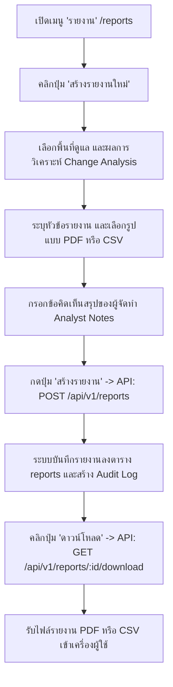

# 14. การสร้างและดาวน์โหลดรายงาน (Generate & Export Reports)

เอกสารนี้อธิบายขั้นตอนการออกรายงานสรุปผลการสำรวจโดรนและการวิเคราะห์ความเปลี่ยนแปลงเชิงพื้นที่ ทั้งในรูปแบบเอกสารสำหรับพิมพ์ (Printable PDF) และรูปแบบตารางข้อมูล (CSV Spreadsheet ที่รองรับภาษาไทย UTF-8 BOM)

---

## 1. วัตถุประสงค์
1. รวบรวมข้อมูลสถิติ ปริมาตรงานดิน (Cut / Fill / Net Volume) พื้นที่ และรูปแปลงที่ผ่านการตรวจสอบแล้ว ออกเป็นเอกสารทางการ
2. สร้างเอกสารสรุปผลการดำเนินงานสำหรับส่งมอบให้ผู้บริหาร วิศวกรโครงการ หรือหน่วยงานภายนอก
3. ดาวน์โหลดรายงานในรูปแบบไฟล์ CSV พร้อมรหัส UTF-8 BOM เพื่อเปิดใช้งานใน Microsoft Excel โดยที่ตัวอักษรภาษาไทยไม่เพี้ยน (No Mojibake)
4. จัดเก็บประวัติการออกรายงานลงในฐานข้อมูลกลางเพื่อการสืบค้นย้อนหลัง

---

## 2. สิ่งที่ต้องเตรียม
1. บัญชีผู้ใช้งานที่มีสิทธิ์ระดับ `admin`, `project_manager` หรือ `analyst` (ระดับ `viewer` สามารถดูและดาวน์โหลดรายงานที่มีอยู่แล้วได้ แต่ไม่สามารถสร้างรายงานใหม่ได้)
2. ผลการวิเคราะห์การเปลี่ยนแปลง (`change_analyses`) ที่ผ่านการตรวจสอบรูปแปลงแล้วอย่างน้อย 1 รายการ
3. พื้นที่ดูแลเป้าหมาย (`areaId`)

---

## 3. ขั้นตอนการทำงานทีละข้อ



### ขั้นตอนผ่านหน้าเว็บ Web UI (`/reports`)
1. เข้าสู่ระบบและคลิกที่เมนู **"รายงาน (Reports)"** (`/reports`) ในแถบเมนูด้านซ้าย
2. คลิกปุ่ม **"สร้างรายงานใหม่ (Generate Report)"** ที่มุมบนขวา
3. ในหน้าต่างโมดอล กรอกข้อมูลดังนี้:
   - **พื้นที่ดูแล (Managed Area)**: เลือกพื้นที่ที่ต้องการออกรายงาน
   - **ผลการวิเคราะห์ (Change Analysis)**: เลือกรอบการวิเคราะห์เปรียบเทียบที่ต้องการสรุปสถิติ
   - **ชื่อหัวข้อรายงาน (Title)**: เช่น *"รายงานสรุปปริมาตรงานดินประจำเดือนตุลาคม 2569"*
   - **ประเภทรายงาน (Report Type)**: 
     - `change_summary`: สรุปผลความเปลี่ยนแปลงและงานดิน
     - `executive_brief`: สรุปภาพรวมสำหรับผู้บริหาร
     - `compliance_audit`: รายงานตรวจสอบความถูกต้องทางสัญญา
   - **รูปแบบไฟล์ (Format)**:
     - `pdf`: เอกสารจัดหน้าพิมพ์สวยงาม เหมาะสำหรับสั่งพิมพ์หรือเซ็นอนุมัติ
     - `csv`: ตารางข้อมูลสรุป เหมาะสำหรับการนำไปคำนวณต่อใน Excel
   - **ข้อคิดเห็นของนักวิเคราะห์ (Analyst Notes)**: บันทึกข้อสรุปหรือข้อสังเกตเพิ่มเติม
4. คลิกปุ่ม **"ยืนยันการสร้างรายงาน (Confirm Generate)"**
5. ตารางรายงานจะแสดงรายการใหม่พร้อมสถานะ คลิกปุ่ม **"ดาวน์โหลด (Download)"** เพื่อรับไฟล์เข้าสู่คอมพิวเตอร์ของคุณ

---

## 4. คำสั่ง Terminal ที่ต้องใช้จริง หากเกี่ยวข้อง

### 1. สั่งสร้างรายงานใหม่ผ่าน REST API
```bash
# macOS / Linux
TOKEN="eyJhbGciOiJIUzI1NiIsInR5cCI6IkpXVCJ9..."
AREA_ID="67414bc5-1b4e-48f6-8c4d-9e6587c4f101"
ANALYSIS_ID="78512cd6-2a5f-59e7-9d5e-0f7698d5a210"

curl -X POST "http://localhost:4000/api/v1/reports" \
  -H "Authorization: Bearer ${TOKEN}" \
  -H "Content-Type: application/json" \
  -d '{
    "areaId": "'"${AREA_ID}"'",
    "changeAnalysisId": "'"${ANALYSIS_ID}"'",
    "title": "รายงานสรุปปริมาตรงานดินประจำเดือนตุลาคม 2569",
    "reportType": "change_summary",
    "format": "csv",
    "analystNotes": "ปริมาตรดินขุดสอดคล้องกับงวดงานขุดสระเก็บน้ำ โครงการผ่านเกณฑ์ประเมิน"
  }'
```

```powershell
# Windows PowerShell
$Token = "eyJhbGciOiJIUzI1NiIsInR5cCI6IkpXVCJ9..."
$AreaId = "67414bc5-1b4e-48f6-8c4d-9e6587c4f101"
$AnalysisId = "78512cd6-2a5f-59e7-9d5e-0f7698d5a210"

$Body = @{
    areaId = $AreaId
    changeAnalysisId = $AnalysisId
    title = "รายงานสรุปปริมาตรงานดินประจำเดือนตุลาคม 2569"
    reportType = "change_summary"
    format = "csv"
    analystNotes = "ปริมาตรดินขุดสอดคล้องกับงวดงานขุดสระเก็บน้ำ โครงการผ่านเกณฑ์ประเมิน"
} | ConvertTo-Json

Invoke-RestMethod -Uri "http://localhost:4000/api/v1/reports" `
  -Method Post `
  -Headers @{ "Authorization" = "Bearer $Token"; "Content-Type" = "application/json" } `
  -Body $Body
```

### 2. ดาวน์โหลดไฟล์รายงานผ่าน Terminal
```bash
# ดาวน์โหลดไฟล์ CSV
REPORT_ID="99712ab8-4c6e-71f9-1f7f-2e8810f7c432"

curl -X GET "http://localhost:4000/api/v1/reports/${REPORT_ID}/download" \
  -H "Authorization: Bearer ${TOKEN}" \
  -o "GeoMonitor_Report_${REPORT_ID}.csv"

# ดาวน์โหลดไฟล์ HTML/PDF
curl -X GET "http://localhost:4000/api/v1/reports/${REPORT_ID}/download" \
  -H "Authorization: Bearer ${TOKEN}" \
  -o "GeoMonitor_Report_${REPORT_ID}.html"
```

---

## 5. ตัวอย่างข้อมูลที่ถูกต้อง

### ข้อมูล Request Body สำหรับสร้างรายงาน (JSON)
```json
{
  "areaId": "67414bc5-1b4e-48f6-8c4d-9e6587c4f101",
  "changeAnalysisId": "78512cd6-2a5f-59e7-9d5e-0f7698d5a210",
  "title": "รายงานสรุปปริมาตรงานดินประจำเดือนตุลาคม 2569",
  "reportType": "change_summary",
  "format": "csv",
  "analystNotes": "ปริมาตรดินขุดสอดคล้องกับงวดงานขุดสระเก็บน้ำ โครงการผ่านเกณฑ์ประเมิน"
}
```

### ตัวอย่างโครงสร้างเนื้อหาไฟล์ CSV ที่ได้รับ
```csv
รายงานสรุปการวิเคราะห์การเปลี่ยนแปลงและปริมาตรขุดถม (GeoMonitor 3D Report)
หัวข้อรายงาน,รายงานสรุปปริมาตรงานดินประจำเดือนตุลาคม 2569
พื้นที่ดูแล,พื้นที่พัฒนาท่าเรือและนิคมอุตสาหกรรมมาบตาพุด
วันที่ออกรายงาน,26/10/2569 11:35:00
พื้นที่สำรวจรวม (ตร.ม.),500000

สรุปปริมาตรงานดิน (Earthwork Volume Summary)
พื้นที่ที่มีการเปลี่ยนแปลง (ตร.ม.),40000
ปริมาตรขุดดิน / Cut (ลบ.ม.),83600
ปริมาตรถมดิน / Fill (ลบ.ม.),52200
ปริมาตรสุทธิ / Net (ลบ.ม.),-31400
ความเชื่อมั่น (Confidence),93.0%

รายละเอียดรูปแปลงการเปลี่ยนแปลง (Detected Change Features)
ลำดับ,ประเภทการเปลี่ยนแปลง,พื้นที่ (ตร.ม.),การเปลี่ยนระดับความสูงเฉลี่ย (ม.),ปริมาตรโดยประมาณ (ลบ.ม.),สถานะการยืนยัน
1,earthwork_cut,22000,-3.85,83600,ยืนยันแล้ว (Confirmed)
2,earthwork_fill,18000,2.9,52200,ยืนยันแล้ว (Confirmed)
```

---

## 6. ผลลัพธ์ที่ควรเห็น

### ข้อมูล Response จาก API (HTTP 201 Created)
```json
{
  "success": true,
  "data": {
    "id": "99712ab8-4c6e-71f9-1f7f-2e8810f7c432",
    "areaId": "67414bc5-1b4e-48f6-8c4d-9e6587c4f101",
    "title": "รายงานสรุปปริมาตรงานดินประจำเดือนตุลาคม 2569",
    "reportType": "change_summary",
    "format": "csv",
    "fileStorageKey": "reports/67414bc5-1b4e-48f6-8c4d-9e6587c4f101/Report_1792989300000.csv",
    "createdAt": "2026-10-26T04:35:00.000Z"
  },
  "message": "สร้างรายงานสรุปผลการสำรวจเรียบร้อยแล้ว"
}
```

### ผลลัพธ์เมื่อเปิดไฟล์
- **ไฟล์ CSV**: เมื่อดับเบิลคลิกเปิดใน Microsoft Excel หรือ Numbers บน macOS ตัวหนังสือภาษาไทยจะแสดงผลถูกต้องทุกบรรทัด (ไม่เกิดปัญหาภาษาต่างดาว เนื่องจากมี `\uFEFF` UTF-8 Byte Order Mark กำกับไว้ที่ต้นไฟล์)
- **ไฟล์ PDF/HTML**: เมื่อเปิดในเบราว์เซอร์จะแสดงผลในรูปแบบเอกสารทางการพร้อมตารางสถิติและสามารถสั่งพิมพ์ (Print -> Save as PDF) ได้ทันที

---

## 7. วิธีตรวจสอบว่าทำสำเร็จ
1. ตรวจสอบตาราง `reports` ในฐานข้อมูล:
   ```sql
   SELECT id, title, report_type, format, file_storage_key, created_at 
   FROM reports 
   ORDER BY created_at DESC 
   LIMIT 1;
   ```
2. ตรวจสอบบันทึกความปลอดภัย `audit_logs`:
   ```sql
   SELECT action, resource_type, resource_id, payload_diff 
   FROM audit_logs 
   WHERE action = 'report.generate' 
   ORDER BY created_at DESC 
   LIMIT 1;
   ```
3. ตรวจสอบขนาดไฟล์ที่ดาวน์โหลดว่ามีข้อมูลจริงและขนาดไฟล์มากกว่า 0 ไบต์:
   ```bash
   ls -lh GeoMonitor_Report_*.csv
   ```

---

## 8. ข้อผิดพลาดที่พบบ่อยและวิธีแก้ไข

| รหัสข้อผิดพลาด | สาเหตุที่เป็นไปได้ | แนวทางแก้ไข |
|---|---|---|
| `NOT_FOUND` | รหัส `areaId` หรือ `changeAnalysisId` ไม่ถูกต้อง | ตรวจสอบรหัสพื้นที่และรหัสการวิเคราะห์จากหน้า `/analysis` อีกครั้ง |
| ภาษาไทยใน Excel เป็นภาษาต่างดาว | โปรแกรมเปิดไฟล์ไม่ได้อ่าน BOM หรือถูกบันทึกซ้ำด้วย ANSI | ไฟล์ที่ดาวน์โหลดจากระบบ GeoMonitor มี UTF-8 BOM กำกับแล้ว หากเปิดผ่าน Excel ให้เลือก "Open" โดยตรง หรือใช้ฟังก์ชัน Import Data -> From Text/CSV โดยเลือก File Origin เป็น "65001 : Unicode (UTF-8)" |
| เบราว์เซอร์บล็อกการดาวน์โหลด | Pop-up blocker ทำงาน | อนุญาตให้โดเมน `localhost:3000` สามารถดาวน์โหลดไฟล์ได้ในตั้งค่าเบราว์เซอร์ |

---

## 9. ข้อควรระวังด้านความปลอดภัย
- รายงานสรุปอาจมีข้อมูลพิกัดความมั่นคงหรือรายละเอียดการถมที่ดินที่มีมูลค่าทางการเงินสูง ควรจัดเก็บในอุปกรณ์ที่เข้ารหัส (Encrypted Drive)
- สิทธิ์การสร้างรายงานถูกจำกัดเฉพาะบทบาทวิเคราะห์และบริหารเท่านั้น ผู้ใช้งานระดับ `viewer` สามารถดูได้เฉพาะรายงานที่ได้รับการอนุมัติแล้ว

---

## 10. ขั้นตอนถัดไป
เมื่อสร้างและจัดเก็บรายงานเรียบร้อยแล้ว หากพบปัญหาการทำงานของระบบระหว่างการใช้งาน สามารถศึกษาวิธีการวิเคราะห์และแก้ไขปัญหาต่าง ๆ ได้ในคู่มือ [15-troubleshooting.md](file:///Users/cangsalak/project/maparmy/docs/user-guide/15-troubleshooting.md)
