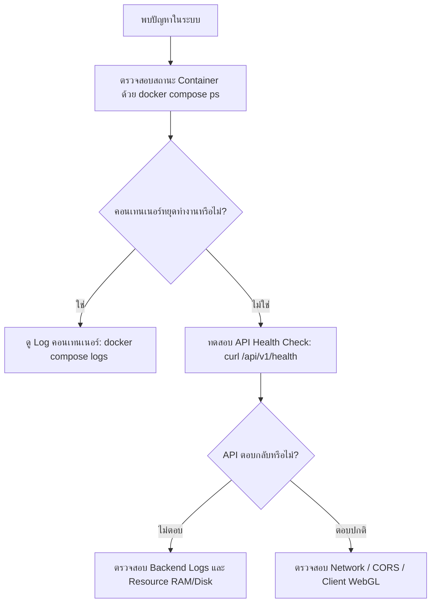

# 15. การแก้ไขปัญหาที่พบบ่อย (Troubleshooting & Incident Recovery)

เอกสารนี้รวบรวมแนวทางการวินิจฉัย การตรวจสอบบันทึกข้อผิดพลาด (Log Analysis) และวิธีการแก้ไขปัญหาที่พบบ่อย 15 สถานการณ์ ตั้งแต่ระดับโครงสร้างพื้นฐาน ฐานข้อมูล พื้นที่จัดเก็บ ไปจนถึงกระบวนการประมวลผลและการแสดงผลแผนที่ 3 มิติ

---

## 1. วัตถุประสงค์
1. ให้ผู้ดูแลระบบ (DevOps/Admin) และวิศวกรผู้ใช้งานสามารถตรวจหาสาเหตุและแก้ไขปัญหาได้ด้วยตนเองอย่างเป็นระบบ
2. ครอบคลุมปัญหา 15 กรณีหลักที่เกิดขึ้นจริงในสภาพแวดล้อม On-premises
3. ลดระยะเวลาการหยุดชะงักของระบบ (Downtime) และรักษาความสมบูรณ์ของข้อมูลภูมิสารสนเทศ

---

## 2. สิ่งที่ต้องเตรียม
1. สิทธิ์เข้าถึงเครื่องเซิร์ฟเวอร์ (SSH หรือ Terminal Console) ด้วยสิทธิ์ `sudo` หรือ `docker`
2. เครื่องมือตรวจสอบคำสั่งพื้นฐาน: `docker`, `curl`, `psql`, `grep`, `df`, `free`
3. ไฟล์ `.env` ของโปรเจกต์สำหรับตรวจสอบการตั้งค่าพอร์ตและรหัสผ่าน

---

## 3. ขั้นตอนการวินิจฉัยปัญหาทั่วไป (Systematic Triage Workflow)



---

## 4. วิธีแก้ไขปัญหา 15 สถานการณ์ที่พบบ่อย

### 1. Frontend เปิดไม่ได้ (Web App Inaccessible)
- **อาการ**: เปิดเบราว์เซอร์ไปที่ `http://localhost:3000` แล้วขึ้น "This site can't be reached" หรือ Connection Refused
- **การตรวจสอบ Log**:
  ```bash
  docker compose logs -f geomonitor-web
  # หรือหากรันแบบ Local Node.js: ตรวจสอบหน้าต่างที่รัน `npm run dev:web`
  ```
- **สาเหตุที่เป็นไปได้**: Service ยังไม่สตาร์ต, พอร์ต 3000 ชนกับแอปพลิเคชันอื่น, หรือรันบนเครื่องเซิร์ฟเวอร์แต่ไม่ได้เปิด Binding `0.0.0.0`
- **วิธีแก้ไข**:
  1. ตรวจสอบว่าพอร์ต 3000 ถูกใช้งานอยู่หรือไม่:
     ```bash
     lsof -i :3000  # macOS/Linux
     netstat -ano | findstr 3000  # Windows
     ```
  2. สั่งเริ่มคอนเทนเนอร์ใหม่:
     ```bash
     docker compose restart geomonitor-web
     ```

---

### 2. Backend API ไม่ตอบสนอง หรือส่งผล HTTP 500 (API Unresponsive)
- **อาการ**: หน้าเว็บแจ้งเตือน "API Error" หรือ `curl http://localhost:4000/api/v1/health` ไม่ตอบสนอง
- **การตรวจสอบ Log**:
  ```bash
  docker compose logs -f geomonitor-api --tail=100
  ```
- **สาเหตุที่เป็นไปได้**: การเชื่อมต่อ PostgreSQL หรือ Redis หลุด, มี Unhandled Exception จากพารามิเตอร์ผิดพลาด
- **วิธีแก้ไข**:
  1. ทดสอบว่า PostgreSQL ทำงานปกติหรือไม่ผ่าน `docker compose ps`
  2. หาก API แฮงก์เนื่องจาก Out of Memory สั่งรีสตาร์ต:
     ```bash
     docker compose restart geomonitor-api
     ```

---

### 3. PostgreSQL เชื่อมต่อไม่ได้ (Connection Refused to Port 5432)
- **อาการ**: API พ่น Error `ECONNREFUSED 127.0.0.1:5432` หรือ `Connection terminated unexpectedly`
- **การตรวจสอบ Log**:
  ```bash
  docker compose logs -f geomonitor-postgres --tail=100
  ```
- **สาเหตุที่เป็นไปได้**: รหัสผ่าน `POSTGRES_PASSWORD` ใน `.env` ไม่ตรงกับที่ฐานข้อมูลเคยสร้างไว้ใน Volume, หรือคอนเทนเนอร์หยุดทำงาน
- **วิธีแก้ไข**:
  1. ตรวจสอบว่า Container ทำงานอยู่:
     ```bash
     docker compose ps geomonitor-postgres
     ```
  2. ทดสอบเชื่อมต่อผ่าน psql โดยตรง:
     ```bash
     docker compose exec geomonitor-postgres psql -U geomonitor -d geomonitor_db -c "SELECT 1;"
     ```
  3. หากรหัสผ่านไม่ตรง และต้องการล้าง Volume เริ่มใหม่ (คำเตือน: ข้อมูลจะหายทั้งหมด):
     ```bash
     docker compose down -v
     docker compose up -d geomonitor-postgres
     ```

---

### 4. PostGIS Extension ไม่พร้อมใช้งาน (PostGIS Extension Missing)
- **อาการ**: Migration หรือ Query พังด้วยข้อผิดพลาด: `type "geometry" does not exist` หรือ `function st_geomfromgeojson does not exist`
- **การตรวจสอบ**:
  ```bash
  docker compose exec geomonitor-postgres psql -U geomonitor -d geomonitor_db -c "\dx postgis"
  ```
- **สาเหตุที่เป็นไปได้**: มีการเปลี่ยนไปใช้ Docker Image มาตรฐาน `postgres:16` แทนที่จะเป็น `postgis/postgis:16-3.4`
- **วิธีแก้ไข**:
  1. แก้ไข `docker-compose.yml` ให้ใช้ image ที่มี PostGIS ติดตั้งมาด้วย:
     ```yaml
     image: postgis/postgis:16-3.4
     ```
  2. สั่งเปิด Extension ในฐานข้อมูลด้วยคำสั่ง SQL:
     ```sql
     CREATE EXTENSION IF NOT EXISTS postgis;
     CREATE EXTENSION IF NOT EXISTS postgis_topology;
     ```

---

### 5. MinIO อัปโหลดไฟล์ไม่ได้ (Object Storage Upload Failure)
- **อาการ**: หน้าเว็บอัปโหลดภาพถ่ายโดรนขึ้นข้อความ "S3 Storage Connection Failed" หรือ Status Code 502/503
- **การตรวจสอบ Log**:
  ```bash
  docker compose logs -f geomonitor-minio --tail=100
  ```
- **สาเหตุที่เป็นไปได้**: Bucket `geomonitor-assets` หรือ `geomonitor-reports` ยังไม่ได้ถูกสร้าง, หรือ MinIO Keys ใน `.env` ไม่ตรงกับ MinIO Server
- **วิธีแก้ไข**:
  1. ตรวจสอบว่าคอนเทนเนอร์ MinIO ทำงานอยู่:
     ```bash
     curl -I http://localhost:9000/minio/health/live
     ```
  2. เข้าหน้า MinIO Console (`http://localhost:9001`) ตรวจสอบว่ามี Bucket ดังกล่าวอยู่หรือไม่ หากไม่มี ให้สร้าง Bucket ชื่อ `geomonitor-assets` และ `geomonitor-reports`
  3. ตรวจสอบสิทธิ์ Access Policy ของ Bucket ให้ถูกต้อง

---

### 6. Worker ไม่รับงานประมวลผล (Worker Queue Inactive)
- **อาการ**: กดเริ่ม Photogrammetry แล้วสถานะค้างอยู่ที่ `pending` หรือแถบความคืบหน้าไม่ขยับ
- **การตรวจสอบ Log**:
  ```bash
  docker compose logs -f geomonitor-worker --tail=100
  docker compose logs -f geomonitor-redis --tail=50
  ```
- **สาเหตุที่เป็นไปได้**: การเชื่อมต่อ Redis หลุด, Worker ขัดข้องและหยุดทำงาน (Crash), หรือ Queue Name ใน Worker ไม่ตรงกับ API (`geomonitor-jobs`)
- **วิธีแก้ไข**:
  1. ตรวจสอบว่า Redis ทำงานปกติ:
     ```bash
     docker compose exec geomonitor-redis redis-cli ping
     # ต้องตอบกลับว่า PONG
     ```
  2. สั่งรีสตาร์ต Worker:
     ```bash
     docker compose restart geomonitor-worker
     ```

---

### 7. Photogrammetry ใช้ RAM หรือ Disk ไม่เพียงพอ (Out Of Memory / Disk Full)
- **อาการ**: Worker พังระหว่างประมวลผลโมเดล 3D หรือระบบค้าง (Exit Code 137 - OOM Killed)
- **การตรวจสอบ**:
  ```bash
  # ตรวจสอบพื้นที่ฮาร์ดดิสก์
  df -h
  # ตรวจสอบหน่วยความจำ RAM และ Swap
  free -h
  # ตรวจสอบว่า Docker ถูก OOM Killed หรือไม่
  docker inspect <container-id> | grep OOMKilled
  ```
- **วิธีแก้ไข**:
  1. เพิ่ม RAM ใน Docker Desktop Preferences เป็นอย่างน้อย 16 GB - 32 GB
  2. สำหรับ Linux Server ให้เพิ่ม Swap Space อย่างน้อย 16 GB:
     ```bash
     sudo fallocate -l 16G /swapfile
     sudo chmod 600 /swapfile
     sudo mkswap /swapfile
     sudo swapon /swapfile
     ```
  3. ล้างไฟล์ชั่วคราวและ Docker Cache ที่ไม่ใช้แล้ว:
     ```bash
     docker system prune -a --volumes
     ```

---

### 8. ภาพถ่ายโดรนไม่มี GPS Metadata (Missing EXIF GPS Coordinates)
- **อาการ**: อัปโหลดภาพแล้วระบบแจ้งเตือนว่า "ไม่พบพิกัดภูมิศาสตร์ในภาพถ่าย (Missing EXIF GPS)"
- **สาเหตุ**: กล้องโดรนบันทึกภาพก่อนที่เซ็นเซอร์ GNSS/RTK จะล็อกสัญญาณดาวเทียมได้ (GPS Not Locked) หรือโปรแกรมบีบอัดภาพตัดข้อมูล EXIF Header ออก
- **วิธีแก้ไข**:
  1. ตรวจสอบไฟล์ภาพด้วยเครื่องมือ `exiftool`:
     ```bash
     exiftool DJI_0001.JPG | grep -i "GPS"
     ```
  2. หากไม่มี GPS ให้นำเข้าไฟล์พิกัดศูนย์กลางภาพ (Image Coordinate CSV/Text file) จาก Log การบินของโดรนเข้าระบบ
  3. สำหรับการบินสำรวจครั้งต่อไป ต้องตรวจสอบให้โดรนล็อกสัญญาณดาวเทียมอย่างน้อย 12-16 ดวงก่อนสั่งเริ่มภารกิจ

---

### 9. ภาพถ่ายไม่เพียงพอสำหรับสร้างแบบจำลอง (Insufficient Overlap)
- **อาการ**: การประมวลผล Photogrammetry ล้มเหลวที่ขั้นตอนสกัดจุดรวมภาพ (Tie Points Extraction) หรือได้เมฆจุดเบาบาง (Sparse Point Cloud)
- **สาเหตุ**: อัตราการซ้อนทับของภาพ (Overlap) ต่ำกว่า 70% ด้านหน้า (Forward) หรือ 60% ด้านข้าง (Side) หรือบินต่ำเกินไปทำให้ภาพมีพื้นผิวซ้ำซาก (Homogeneous Texture)
- **วิธีแก้ไข**:
  1. กำหนดค่าโปรแกรมวางแผนการบินโดรน (เช่น DJI Pilot, Pix4Dcapture) ให้อัตรา Overlap อยู่ที่ **75% ด้านหน้า และ 70% ด้านข้าง** เป็นอย่างต่ำ
  2. ควบคุมความเร็วในการบินสำรวจไม่ให้เร็วเกินไปเพื่อลดภาพเบลอ (Motion Blur)

---

### 10. ระบบพิกัดไม่ตรงกัน (Coordinate Reference System - CRS Mismatch)
- **อาการ**: แผนที่แสดงผลรูปแปลงเยื้องจากตำแหน่งจริงหลายร้อยเมตร หรือเปรียบเทียบสอง Survey แล้วเหลื่อมกัน
- **สาเหตุ**: ข้อมูลชั้นหนึ่งใช้พิกัดภูมิศาสตร์ EPSG:4326 (Lat/Lng) แต่อีกชั้นหนึ่งใช้พิกัดกริด EPSG:32647 (UTM Zone 47N) โดยไม่มีการแปลงพิกัด (Reprojection)
- **วิธีแก้ไข**:
  1. ตรวจสอบ CRS ของไฟล์ GeoTIFF:
     ```bash
     gdalinfo orthomosaic.tif | grep "AUTHORITY"
     ```
  2. แปลงพิกัดไฟล์ด้วย GDAL ให้เป็น EPSG:4326 หรือ EPSG:32647 ให้ตรงกัน:
     ```bash
     gdalwarp -t_srs EPSG:4326 orthomosaic_utm.tif orthomosaic_wgs84.tif
     ```

---

### 11. CesiumJS ไม่สามารถแสดง Layer ได้ (CesiumJS WebGL / Layer Error)
- **อาการ**: หน้าจอ 3D ขึ้นจอดำ หรือแจ้งเตือน "An error occurred while rendering. Context lost"
- **สาเหตุ**: เบราว์เซอร์ไม่ได้เปิดใช้ Hardware Acceleration, การ์ดจอไม่รองรับ WebGL 2.0, หรือ Cesium Ion Token หมดอายุ
- **วิธีแก้ไข**:
  1. ตรวจสอบการเปิดใช้งาน Hardware Acceleration ในการตั้งค่า Chrome/Edge:
     - เข้าไปที่ `chrome://settings/system` แล้วเปิด **"Use graphics acceleration when available"**
     - เข้าไปที่ `chrome://gpu` เพื่อตรวจสอบว่า WebGL 2.0 ทำงานปกติ (Hardware Accelerated)
  2. ตรวจสอบไฟล์ `.env` ว่าได้ระบุ `NEXT_PUBLIC_CESIUM_ION_TOKEN` หรือไม่ หากไม่มี ระบบจะใช้ Base Imagery Fallback

---

### 12. ผลตรวจจับความเปลี่ยนแปลงมี False Positives สูงมาก
- **อาการ**: ระบบแจ้งเตือนว่ามีงานดินขุด-ถมเต็มพื้นที่ ทั้งที่ไม่ได้มีการก่อสร้างจริง
- **สาเหตุ**: เงาตกกระทบของเมฆหนา (Cloud Shadows) แสงแดดต่างช่วงเวลา หรือยอดไม้ในป่าเคลื่อนไหวตามลม
- **วิธีแก้ไข**:
  1. ปรับค่า Threshold ความต่างระดับความสูง ($\epsilon$) ในการวิเคราะห์ให้สูงขึ้น เช่น จาก $0.10\text{ m}$ เป็น $0.25\text{ m}$ เพื่อตัดสิ่งรบกวน
  2. นักวิเคราะห์สามารถใช้ฟังก์ชัน **Analyst Review** (`POST /api/v1/change-features/:id/review`) เพื่อทำเครื่องหมายรูปแปลงที่เป็นเงาว่าเป็น `false_positive_shadow`

---

### 13. การเปรียบเทียบสอง Survey ให้ผลคลาดเคลื่อน (Survey Misalignment)
- **อาการ**: ถนนและสิ่งปลูกสร้างถาวรในผลต่างความสูง $\Delta Z$ ไม่เป็นศูนย์ (มีค่าคลาดเคลื่อน $\pm 1-2\text{ m}$)
- **สาเหตุ**: ไม่ได้ใช้หมุดควบคุมภาคพื้นดิน (Ground Control Points - GCP) หรือการรังวัดพิกัดดาวเทียมทั้งสองรอบมีความคลาดเคลื่อนสัมพัทธ์ (Relative Shift)
- **วิธีแก้ไข**:
  1. ติดตั้งหมุด GCP ถาวรอย่างน้อย 5 จุดกระจายทั่วพื้นที่ และรังวัดด้วยเครื่องรับสัญญาณ GNSS แบบ RTK/PPK
  2. ใช้เครื่องมือ Align / Co-registration ของโปรแกรม Photogrammetry เพื่อดึงระนาบระดับความสูงของทั้งสองรอบให้ขนานกัน

---

### 14. การดาวน์โหลดรายงานล้มเหลว (Report Download Failed)
- **อาการ**: กดปุ่มดาวน์โหลดรายงานแล้วหน้าจอค้าง หรือ API ส่ง HTTP 404 / 500
- **การตรวจสอบ Log**:
  ```bash
  docker compose logs -f geomonitor-api | grep "reports"
  ```
- **สาเหตุ**: รายงานถูกลบออกจากฐานข้อมูล, หรือข้อมูลในผลการวิเคราะห์มีค่าเป็น Null
- **วิธีแก้ไข**:
  1. ตรวจสอบว่ารายงานมีอยู่จริงในตาราง `reports`
  2. หากต้องการดาวน์โหลดแบบ CSV ให้ทดสอบยิงคำสั่งผ่าน `curl` เพื่อตรวจสอบว่า API พ่น Error ใดออกมา (ดูหัวข้อ [14-generate-reports.md](file:///Users/cangsalak/project/maparmy/docs/user-guide/14-generate-reports.md))

---

### 15. การกู้คืนฐานข้อมูลไม่สำเร็จ (Database Restore Failure)
- **อาการ**: รันคำสั่ง `pg_restore` แล้วแจ้งข้อผิดพลาด: `role "geomonitor" does not exist` หรือ `relation already exists`
- **สาเหตุ**: กู้คืนทับฐานข้อมูลที่มีตารางเดิมอยู่แล้วโดยไม่ได้ใช้แฟล็ก `--clean` หรือชื่อผู้ใช้ฐานข้อมูลปลายทางไม่ตรงกับต้นทาง
- **วิธีแก้ไข**:
  1. ใช้คำสั่ง `pg_restore` พร้อมแฟล็ก `--clean --if-exists --no-owner`:
     ```bash
     pg_restore -U geomonitor -d geomonitor_db --clean --if-exists --no-owner backup_file.dump
     ```
  2. ศึกษารายละเอียดคำสั่งการสำรองและกู้คืนที่ถูกต้องในบทถัดไป [16-backup-and-restore.md](file:///Users/cangsalak/project/maparmy/docs/user-guide/16-backup-and-restore.md)

---

## 5. ตารางสรุปช่องทางการตรวจสอบบันทึกระบบ (Log Inspection Matrix)

| ส่วนประกอบ | คำสั่งสำหรับดู Real-time Logs | ตำแหน่งไฟล์ภายในเครื่อง |
|---|---|---|
| **API Server** | `docker compose logs -f geomonitor-api` | stdout / Docker logs |
| **Worker Queue** | `docker compose logs -f geomonitor-worker` | stdout / Docker logs |
| **PostgreSQL / PostGIS** | `docker compose logs -f geomonitor-postgres` | `/var/lib/postgresql/data/pg_log` |
| **MinIO Storage** | `docker compose logs -f geomonitor-minio` | stdout / Docker logs |
| **Redis Cache** | `docker compose logs -f geomonitor-redis` | stdout / Docker logs |
| **Next.js Web** | `docker compose logs -f geomonitor-web` | stdout / Docker logs |

---

## 6. ข้อควรระวังด้านความปลอดภัย
- เมื่อส่งออก Logs เพื่อขอรับการสนับสนุนทางเทคนิค **ห้ามแนบไฟล์ `.env` หรือ String ที่มีรหัสผ่านและ JWT Token จริง** ให้เซ็นเซอร์ข้อมูลลับก่อนเสมอ
- การรันคำสั่งล้างข้อมูลแคชหรือการ Kill Process ควรกระทำโดยผู้ดูแลระบบที่ได้รับอนุญาตเท่านั้น

---

## 7. ขั้นตอนถัดไป
เพื่อป้องกันความเสี่ยงจากการสูญหายของข้อมูลในกรณีที่เกิดวิกฤตระบบล่ม ผู้ดูแลระบบจำเป็นต้องจัดทำระบบสำรองข้อมูลอัตโนมัติ ศึกษาขั้นตอนได้ที่ [16-backup-and-restore.md](file:///Users/cangsalak/project/maparmy/docs/user-guide/16-backup-and-restore.md)
