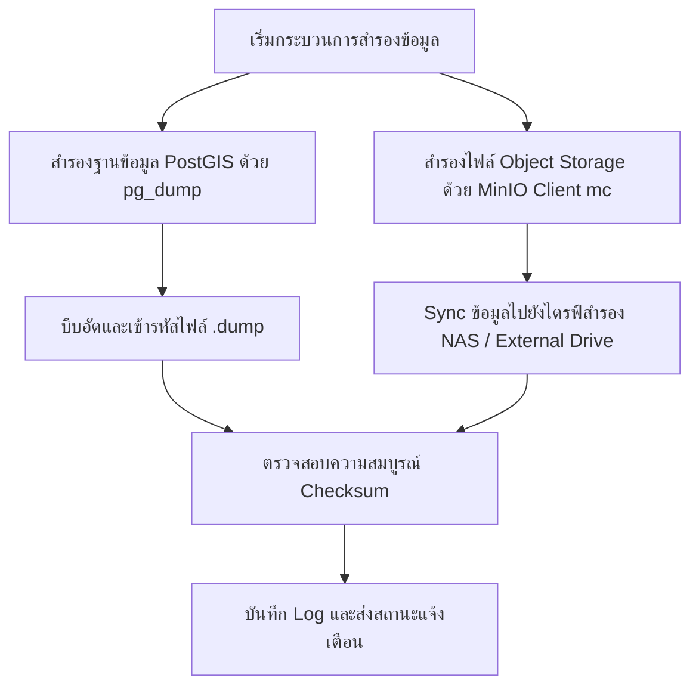

# 16. การสำรองและกู้คืนข้อมูล (Backup & Disaster Recovery)

เอกสารนี้อธิบายขั้นตอนการสำรองข้อมูล (Backup) และการกู้คืนระบบเมื่อเกิดภัยพิบัติ (Disaster Recovery) สำหรับระบบ GeoMonitor 3D ครอบคลุมทั้งฐานข้อมูลเชิงพื้นที่ PostgreSQL + PostGIS และไฟล์ภาพถ่ายภูมิสารสนเทศขนาดใหญ่ใน MinIO Object Storage

---

## 1. วัตถุประสงค์
1. จัดทำนโยบายและขั้นตอนการสำรองข้อมูล (Backup Procedures) เพื่อป้องกันการสูญหายของข้อมูลภูมิสารสนเทศ
2. รองรับการกู้คืนข้อมูลอย่างสมบูรณ์ (Full Recovery) ให้ระบบกลับมาทำงานได้ตามเป้าหมาย RPO (Recovery Point Objective) และ RTO (Recovery Time Objective)
3. สำรองข้อมูลทั้งสองส่วนที่แยกจากกัน:
   - **ส่วนที่ 1: Structured Spatial Data** — โครงสร้างโครงการ, รูปแปลงพื้นที่, ตารางรังวัด, ผลการวิเคราะห์ และ Audit Logs ใน PostgreSQL
   - **ส่วนที่ 2: Unstructured Geospatial Assets** — ไฟล์ภาพถ่ายโดรนดิบ (Raw Images), GeoTIFF Orthomosaic, DSM, Point Clouds และไฟล์รายงาน PDF ใน MinIO

---

## 2. สิ่งที่ต้องเตรียม
1. สิทธิ์ `root` หรือ `sudo` บนเครื่องแม่ข่าย On-premises
2. พื้นที่จัดเก็บข้อมูลภายนอก (External Storage, NAS หรือ SAN) ที่เชื่อมต่อเข้ากับเครื่องเซิร์ฟเวอร์
3. ติดตั้งเครื่องมือจัดการ: `docker`, `pg_dump`, `pg_restore`, `mc` (MinIO Client)
4. ไฟล์รหัสผ่านของระบบจาก `.env`

---

## 3. ขั้นตอนการสำรองข้อมูล (Backup Workflow)



---

## 4. คำสั่ง Terminal สำหรับการสำรองข้อมูล (Backup Commands)

### 1. การสำรองฐานข้อมูล PostgreSQL + PostGIS
ใช้คำสั่ง `pg_dump` ผ่าน Docker Container โดยบันทึกในรูปแบบ Custom Binary Format (`-Fc`) ซึ่งรองรับการบีบอัดข้อมูลเชิงพื้นที่และกู้คืนได้อย่างรวดเร็ว

```bash
# macOS / Linux
# กำหนดตัวแปรวันที่และโฟลเดอร์สำรองข้อมูล
BACKUP_DIR="/opt/geomonitor/backups/db"
TIMESTAMP=$(date +"%Y%m%d_%H%M%S")
mkdir -p "${BACKUP_DIR}"

# ดำเนินการสำรองข้อมูล
docker compose exec -T geomonitor-postgres pg_dump \
  -U geomonitor \
  -d geomonitor_db \
  -F c \
  -b -v \
  -f "/tmp/geomonitor_backup_${TIMESTAMP}.dump"

# คัดลอกไฟล์ออกจาก Container มายังเครื่อง Host
docker compose cp "geomonitor-postgres:/tmp/geomonitor_backup_${TIMESTAMP}.dump" "${BACKUP_DIR}/"

# ลบไฟล์ชั่วคราวใน Container
docker compose exec -T geomonitor-postgres rm -f "/tmp/geomonitor_backup_${TIMESTAMP}.dump"

echo "Database backup completed: ${BACKUP_DIR}/geomonitor_backup_${TIMESTAMP}.dump"
```

```powershell
# Windows PowerShell
$Timestamp = Get-Date -Format "yyyyMMdd_HHmmss"
$BackupDir = "C:\geomonitor\backups\db"
New-Item -ItemType Directory -Force -Path $BackupDir | Out-Null

docker compose exec -T geomonitor-postgres pg_dump `
  -U geomonitor `
  -d geomonitor_db `
  -F c `
  -b -v `
  -f "/tmp/geomonitor_backup_$Timestamp.dump"

docker compose cp "geomonitor-postgres:/tmp/geomonitor_backup_$Timestamp.dump" "$BackupDir\"
docker compose exec -T geomonitor-postgres rm -f "/tmp/geomonitor_backup_$Timestamp.dump"

Write-Host "Database backup completed: $BackupDir\geomonitor_backup_$Timestamp.dump"
```

---

### 2. การสำรองไฟล์ใน MinIO Object Storage
ใช้เครื่องมือ MinIO Client (`mc`) เพื่อจำลองข้อมูล (Mirror) ไปยังพื้นที่จัดเก็บสำรอง

```bash
# 1. ตั้งค่าการเชื่อมต่อ mc ไปยัง Local MinIO (ทำครั้งแรก)
mc alias set localminio http://localhost:9000 minioadmin minioadmin123

# 2. จำลองข้อมูล Bucket ไฟล์สำรวจโดรน (geomonitor-assets) ไปยัง NAS หรือโฟลเดอร์สำรอง
mc mirror --preserve --overwrite localminio/geomonitor-assets /mnt/nas/backups/minio/geomonitor-assets/

# 3. จำลองข้อมูล Bucket รายงาน (geomonitor-reports)
mc mirror --preserve --overwrite localminio/geomonitor-reports /mnt/nas/backups/minio/geomonitor-reports/
```

---

## 5. คำสั่ง Terminal สำหรับการกู้คืนข้อมูล (Restore Commands)

### 1. การกู้คืนฐานข้อมูล PostgreSQL + PostGIS (Disaster Recovery)

> [!CAUTION]
> การกู้คืนข้อมูลจะลบตารางเดิมและเขียนทับด้วยข้อมูลจากไฟล์ Backup ควรตรวจสอบให้แน่ใจว่าได้ระบุไฟล์เป้าหมายถูกต้อง

```bash
# macOS / Linux
RESTORE_FILE="/opt/geomonitor/backups/db/geomonitor_backup_20261026_113000.dump"

# คัดลอกไฟล์เข้าไปใน Container
docker compose cp "${RESTORE_FILE}" geomonitor-postgres:/tmp/restore.dump

# ดำเนินการกู้คืนข้อมูลด้วย pg_restore
docker compose exec -T geomonitor-postgres pg_restore \
  -U geomonitor \
  -d geomonitor_db \
  --clean \
  --if-exists \
  --no-owner \
  --no-privileges \
  -v "/tmp/restore.dump"

# ลบไฟล์ชั่วคราว
docker compose exec -T geomonitor-postgres rm -f /tmp/restore.dump

echo "Database restored successfully!"
```

```powershell
# Windows PowerShell
$RestoreFile = "C:\geomonitor\backups\db\geomonitor_backup_20261026_113000.dump"

docker compose cp "$RestoreFile" geomonitor-postgres:/tmp/restore.dump

docker compose exec -T geomonitor-postgres pg_restore `
  -U geomonitor `
  -d geomonitor_db `
  --clean `
  --if-exists `
  --no-owner `
  --no-privileges `
  -v "/tmp/restore.dump"

docker compose exec -T geomonitor-postgres rm -f /tmp/restore.dump

Write-Host "Database restored successfully!"
```

---

### 2. การกู้คืนไฟล์ MinIO Object Storage
```bash
# ดึงข้อมูลจาก Backup Mirror กลับเข้า MinIO Bucket
mc mirror --preserve --overwrite /mnt/nas/backups/minio/geomonitor-assets/ localminio/geomonitor-assets/
mc mirror --preserve --overwrite /mnt/nas/backups/minio/geomonitor-reports/ localminio/geomonitor-reports/
```

---

## 6. สคริปต์อัตโนมัติสำหรับตั้งเวลาสำรองข้อมูล (Automated Cron Job)

สร้างไฟล์สคริปต์ `/opt/geomonitor/scripts/auto_backup.sh`:

```bash
#!/usr/bin/env bash
set -e

BACKUP_ROOT="/opt/geomonitor/backups"
TIMESTAMP=$(date +"%Y%m%d_%H%M%S")
RETENTION_DAYS=14

mkdir -p "${BACKUP_ROOT}/db" "${BACKUP_ROOT}/minio"

echo "[$(date)] Starting GeoMonitor 3D automated backup..."

# 1. Backup PostgreSQL
cd /Users/cangsalak/project/maparmy
docker compose exec -T geomonitor-postgres pg_dump \
  -U geomonitor -d geomonitor_db -F c -b \
  -f "/tmp/db_${TIMESTAMP}.dump"
docker compose cp "geomonitor-postgres:/tmp/db_${TIMESTAMP}.dump" "${BACKUP_ROOT}/db/db_${TIMESTAMP}.dump"
docker compose exec -T geomonitor-postgres rm -f "/tmp/db_${TIMESTAMP}.dump"

# 2. Backup MinIO
mc mirror --overwrite localminio/geomonitor-assets "${BACKUP_ROOT}/minio/assets/"
mc mirror --overwrite localminio/geomonitor-reports "${BACKUP_ROOT}/minio/reports/"

# 3. Purge backups older than 14 days
find "${BACKUP_ROOT}/db" -type f -name "*.dump" -mtime +${RETENTION_DAYS} -exec rm {} \;

echo "[$(date)] Backup completed successfully."
```

ตั้งค่า Cron Tab ใน Linux (`crontab -e`) ให้ทำงานทุกคืนเวลา 02:00 น.:
```cron
0 2 * * * /opt/geomonitor/scripts/auto_backup.sh >> /var/log/geomonitor_backup.log 2>&1
```

---

## 7. วิธีตรวจสอบว่าทำสำเร็จ
1. ตรวจสอบขนาดไฟล์และความสมบูรณ์ของไฟล์ Dump:
   ```bash
   ls -lh /opt/geomonitor/backups/db/
   # ไฟล์ต้องมีขนาดมากกว่า 100 KB ขึ้นไปตามปริมาณข้อมูล
   ```
2. ตรวจสอบสารบัญของไฟล์ Dump โดยไม่ต้อง Restore:
   ```bash
   docker compose exec -T geomonitor-postgres pg_restore -l /tmp/restore.dump | head -n 30
   # ต้องพบตาราง managed_areas, drone_surveys, change_analyses
   ```
3. ตรวจสอบไฟล์ใน MinIO:
   ```bash
   mc ls localminio/geomonitor-assets/
   ```

---

## 8. ข้อผิดพลาดที่พบบ่อยและวิธีแก้ไข

| รหัสข้อผิดพลาด | สาเหตุที่เป็นไปได้ | แนวทางแก้ไข |
|---|---|---|
| `pg_dump: error: connection to server on socket failed` | คอนเทนเนอร์ฐานข้อมูลปิดอยู่ | สั่ง `docker compose up -d geomonitor-postgres` ก่อนรันคำสั่ง |
| `pg_restore: error: relation "xyz" already exists` | ไม่ได้ใส่แฟล็ก `--clean` | ใส่แฟล็ก `--clean --if-exists` เพื่อให้ลบตารางเดิมก่อนเขียนทับ |
| `mc: command not found` | ยังไม่ได้ติดตั้ง MinIO Client | ดาวน์โหลดไบนารี `mc` จาก min.io หรือใช้คำสั่ง `brew install minio-mc` |
| ฮาร์ดดิสก์เต็มระหว่าง Backup | พื้นที่จัดเก็บไม่พอรองรับขนาด GeoTIFF และภาพถ่ายโดรน | ตั้งค่า Purge Policy หรือย้ายตำแหน่ง Backup ไปยัง Network Storage (NAS) |

---

## 9. ข้อควรระวังด้านความปลอดภัย
- ไฟล์สำรองข้อมูลฐานข้อมูลมีรหัสผ่านแบบแฮช (Bcrypt Hashes) และข้อมูลพิกัดภูมิศาสตร์ความมั่นคง **ห้ามอัปโหลดขึ้น Public Cloud โดยไม่เข้ารหัส**
- ควรกำหนดสิทธิ์ของโฟลเดอร์สำรองข้อมูลเป็น `chmod 700` เพื่อให้เฉพาะบัญชีผู้ดูแลระบบเท่านั้นที่สามารถอ่านไฟล์ได้

---

## 10. ขั้นตอนถัดไป
เมื่อทำความเข้าใจกระบวนการดูแลและสำรองระบบแล้ว หากต้องการค้นหาคำตอบสำหรับคำถามทั่วไปเกี่ยวกับการทำงานของระบบ สามารถอ่านต่อได้ที่ [17-faq.md](file:///Users/cangsalak/project/maparmy/docs/user-guide/17-faq.md)
