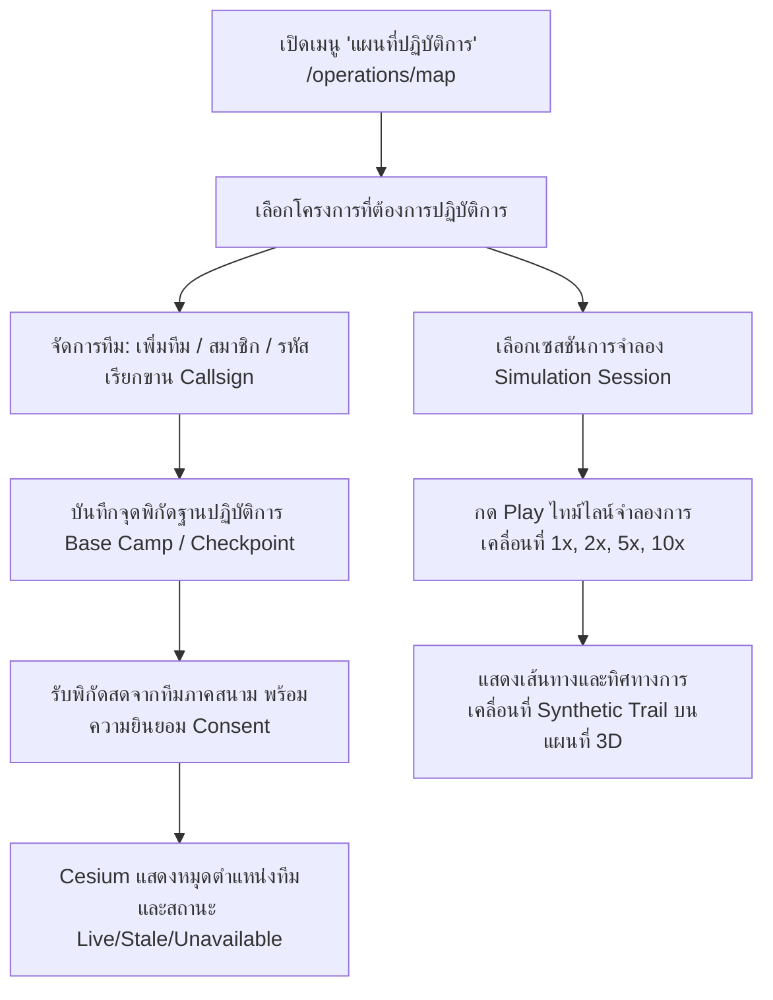

# 18. แผนที่ปฏิบัติการภาคสนามและการจำลองการเคลื่อนที่ (Personnel & Field Operations Mapping)

เอกสารนี้อธิบายขั้นตอนการใช้งานโมดูล **แผนที่ปฏิบัติการภาคสนาม (Operations Map)**, การจัดการทีมและกำลังพล (Team & Personnel Management), การบันทึกฐานปฏิบัติการ/จุดพิกัดสำคัญ (Base Camps & Checkpoints), และระบบจำลองการเคลื่อนที่สำหรับการฝึกซ้อมทางยุทธวิธีหรือตอบโต้เหตุฉุกเฉิน (Movement Simulation & Timeline Playback)

---

## 1. วัตถุประสงค์
1. แสดงภาพรวมทางยุทธการ (Common Operating Picture - COP) แบบบูรณาการบนแผนที่ 2 มิติและลูกโลก 3 มิติ CesiumJS
2. ติดตามและจัดการชุดปฏิบัติการภาคสนาม (Field Teams) สถานะความพร้อม (Active, Standby, Deployed) และตำแหน่งพิกัดล่าสุด
3. แยกแยะความสดใหม่ของข้อมูลพิกัด (Freshness Status) ได้แก่ สด (Live < 5 นาที), ล้าสมัย (Stale 5-60 นาที), และขาดการติดต่อ (Unavailable > 60 นาที)
4. ดำเนินการฝึกซ้อมสถานการณ์จำลอง (Simulation Replay) ด้วยชุดข้อมูลเวลาแบบกำหนดได้ (Deterministic Timeline Playback) โดยระบุว่าเป็นข้อมูลจำลองอย่างชัดเจน ไม่ปะปนกับข้อมูลจริง
5. คุ้มครองความเป็นส่วนตัวและความมั่นคงปลอดภัย โดยกำหนดให้การส่งพิกัดต้องได้รับการยินยอม (Explicit Consent) และบันทึก Audit Logs ทุกครั้งที่มีการเรียกดูประวัติพิกัดย้อนหลัง

---

## 2. สิ่งที่ต้องเตรียม
1. บัญชีผู้ใช้งานที่มีสิทธิ์ระดับ `admin`, `project_manager`, หรือ `analyst` (ระดับ `viewer` สามารถดูแผนที่และเล่นไทม์ไลน์จำลองได้ แต่ไม่สามารถสร้างทีมหรือจุดพิกัดใหม่ได้)
2. โครงการ (Project) ที่สร้างไว้แล้วในระบบ
3. เบราว์เซอร์ที่รองรับ WebGL 2.0 (Google Chrome, Microsoft Edge, Safari หรือ Firefox)

---

## 3. ขั้นตอนการทำงานทีละข้อ



### ขั้นตอนผ่านหน้าเว็บ Web UI (`/operations/map`)
1. เข้าสู่ระบบและคลิกที่เมนู **"แผนที่ปฏิบัติการ"** (`/operations/map`) บนแถบ Navbar ด้านบน
2. **เลือกโครงการ**: ที่แถบเครื่องมือด้านบน ให้เลือกโครงการที่ต้องการบริหารจัดการ
3. **การจัดการทีมปฏิบัติการ (Teams Tab)**:
   - คลิกแท็บ **"ทีม"** ในแผงควบคุมด้านซ้าย
   - คลิกปุ่ม **"เพิ่มทีมปฏิบัติการ"** เพื่อเปิดหน้าต่างบันทึก
   - กรอกชื่อทีม (เช่น *ชุดปฏิบัติการค้นหาและกู้ภัย 1*), รหัสประจำทีม (เช่น *SAR-ALPHA-01*), สถานะ (เช่น *พร้อมปฏิบัติการ - Standby*), และคำอธิบายภารกิจ แล้วกดบันทึก
4. **การบันทึกฐานหรือจุดพิกัดสำคัญ (Locations Tab)**:
   - คลิกแท็บ **"ฐาน/จุด"** ในแผงด้านซ้าย
   - คลิกปุ่ม **"บันทึกฐาน/จุดพิกัดใหม่"**
   - กรอกชื่อฐาน (เช่น *ฐานส่วนหน้า มาบตาพุด*), ประเภทสถานที่ (เช่น *ศูนย์บัญชาการหลัก - Base Camp*), และระบุพิกัดละติจูด/ลองจิจูด (EPSG:4326) แล้วกดบันทึก
5. **การตรวจสอบและบินไปยังตำแหน่ง (Fly-To Navigation)**:
   - คลิกเลือกทีมหรือสถานที่ในรายการด้านซ้าย แผง **Inspector** ทางขวามือจะแสดงรายละเอียดและสถิติ
   - คลิกปุ่ม **"บินไปที่จุดนี้ (Fly to location)"** เพื่อให้กล้อง 3D หมุนและซูมไปยังพิกัดเป้าหมายโดยอัตโนมัติ
6. **การเล่นสถานการณ์จำลอง (Simulation Playback)**:
   - ที่แถบควบคุมไทม์ไลน์ด้านล่าง ให้เลือกรอบการจำลอง (เช่น *การฝึกซ้อมค้นหาและส่งกลับสายแพทย์*)
   - กดปุ่ม **Play** เพื่อเริ่มเล่นการเคลื่อนที่ของหน่วยจำลอง
   - ปรับสปีดการเล่นได้ที่ปุ่ม **1x, 2x, 5x, 10x** หรือลากแถบ Scrub Slider ไปยังเวลาที่ต้องการ
   - หน้าจอจะแสดงป้ายเตือนสีเหลืองกำกับเสมอว่า **"ข้อมูลจำลองการเคลื่อนที่ (SYNTHETIC ONLY)"** เพื่อป้องกันความสับสนกับข้อมูลจริง

---

## 4. คำสั่ง Terminal ที่ต้องใช้จริง หากเกี่ยวข้อง

### 1. การส่งพิกัดตำแหน่งภาคสนามที่ได้รับอนุญาต (Authorized Location Update)
```bash
# macOS / Linux
TOKEN="eyJhbGciOiJIUzI1NiIsInR5cCI6IkpXVCJ9..."
PROJECT_ID="46f89ef7-1111-4444-8888-000000000001"
TEAM_ID="a1b2c3d4-2222-4444-8888-111111111111"

curl -X POST "http://localhost:4000/api/v1/location-updates" \
  -H "Authorization: Bearer ${TOKEN}" \
  -H "Content-Type: application/json" \
  -d '{
    "projectId": "'"${PROJECT_ID}"'",
    "teamId": "'"${TEAM_ID}"'",
    "deviceIdentifier": "TAC-DEVICE-01",
    "timestamp": "'$(date -u +"%Y-%m-%dT%H:%M:%SZ")'",
    "latitude": 12.682,
    "longitude": 101.152,
    "altitudeM": 24.5,
    "accuracyM": 1.8,
    "source": "field_app",
    "consentConfirmed": true
  }'
```

```powershell
# Windows PowerShell
$Token = "eyJhbGciOiJIUzI1NiIsInR5cCI6IkpXVCJ9..."
$ProjectId = "46f89ef7-1111-4444-8888-000000000001"
$TeamId = "a1b2c3d4-2222-4444-8888-111111111111"

$Body = @{
    projectId = $ProjectId
    teamId = $TeamId
    deviceIdentifier = "TAC-DEVICE-01"
    timestamp = (Get-Date).ToUniversalTime().ToString("yyyy-MM-ddTHH:mm:ssZ")
    latitude = 12.682
    longitude = 101.152
    altitudeM = 24.5
    accuracyM = 1.8
    source = "field_app"
    consentConfirmed = $true
} | ConvertTo-Json

Invoke-RestMethod -Uri "http://localhost:4000/api/v1/location-updates" `
  -Method Post `
  -Headers @{ "Authorization" = "Bearer $Token"; "Content-Type" = "application/json" } `
  -Body $Body
```

### 2. การดึงพิกัดล่าสุดของทุกทีมในโครงการ
```bash
curl -X GET "http://localhost:4000/api/v1/location-updates/latest?projectId=${PROJECT_ID}" \
  -H "Authorization: Bearer ${TOKEN}"
```

### 3. การดึงประวัติการเคลื่อนที่ย้อนหลัง (บันทึก Audit Log โดยอัตโนมัติ)
```bash
curl -X GET "http://localhost:4000/api/v1/location-updates/history?teamId=${TEAM_ID}" \
  -H "Authorization: Bearer ${TOKEN}"
```

---

## 5. ตัวอย่างข้อมูลที่ถูกต้อง

### ข้อมูลสร้างทีมปฏิบัติการ (Request JSON)
```json
{
  "projectId": "46f89ef7-1111-4444-8888-000000000001",
  "name": "ชุดปฏิบัติการค้นหาและกู้ภัย 1 (SAR Team Alpha)",
  "identifier": "SAR-ALPHA-01",
  "description": "ชุดปฏิบัติการตอบโต้ภัยพิบัติทางอุตสาหกรรมและกู้ชีพฉุกเฉิน",
  "status": "deployed"
}
```

### ข้อมูลพิกัดสถานที่ฐานปฏิบัติการ (PostGIS GeoJSON)
```json
{
  "projectId": "46f89ef7-1111-4444-8888-000000000001",
  "name": "ศูนย์บัญชาการชั่วคราว ท่าเรือมาบตาพุด",
  "locationType": "base_camp",
  "geometry": {
    "type": "Point",
    "coordinates": [101.14500, 12.67800]
  },
  "description": "พื้นที่ติดตั้งเสาสื่อสารสำรองและลานบินโดรน",
  "status": "active"
}
```

---

## 6. ผลลัพธ์ที่ควรเห็น
- **หมุดตำแหน่งทีม**: แสดงบนแผนที่ 3D ด้วยหมุดสีเขียว (`LIVE`) หากส่งพิกัดภายใน 5 นาที, หมุดสีเหลือง (`STALE`) หาก 5-60 นาที, หรือหมุดสีเทาหากขาดการติดต่อนานเกิน 60 นาที
- **ป้ายชื่อกำกับ**: ปรากฏรหัสประจำทีม เช่น `SAR-ALPHA-01` ลอยอยู่เหนือหมุดอย่างชัดเจน
- **การจำลองการเคลื่อนที่**: แสดงเส้นทางปรุสีฟ้า (`PolylineDash`) และจุดเคลื่อนที่พร้อมระบุความเร็วและทิศทาง โดยมีความเร็วสอดคล้องกับตัวคูณสปีดที่เลือก

---

## 7. วิธีตรวจสอบว่าทำสำเร็จ
1. ตรวจสอบตารางทีมในฐานข้อมูล:
   ```sql
   SELECT id, identifier, name, status FROM teams ORDER BY created_at DESC LIMIT 5;
   ```
2. ตรวจสอบตารางพิกัดสถานที่ใน PostGIS:
   ```sql
   SELECT name, location_type, ST_AsText(geometry) as wkt_geom FROM team_locations LIMIT 5;
   ```
3. ตรวจสอบบันทึกการเข้าดูพิกัดย้อนหลัง (Audit):
   ```sql
   SELECT user_id, action, resource_type, accessed_at FROM location_access_logs ORDER BY accessed_at DESC LIMIT 5;
   ```

---

## 8. ข้อผิดพลาดที่พบบ่อยและวิธีแก้ไข

| รหัสข้อผิดพลาด | สาเหตุที่เป็นไปได้ | แนวทางแก้ไข |
|---|---|---|
| `DUPLICATE_IDENTIFIER` | รหัสประจำทีมซ้ำกับทีมอื่นในโครงการเดียวกัน | เปลี่ยนรหัสประจำทีม (Identifier) ให้ไม่ซ้ำ เช่น `SAR-ALPHA-02` |
| `VALIDATION_ERROR: consentConfirmed` | ส่งอัปเดตพิกัดโดยไม่มี `consentConfirmed: true` | แอปพลิเคชันฝั่งส่งพิกัดต้องให้ผู้ปฏิบัติงานกดยืนยันความยินยอมเปิดเผยพิกัดก่อนส่งข้อมูล |
| แผนที่ 3D ไม่เลื่อนตามการจำลอง | ไม่ได้กดปุ่ม Play หรือเซสชันไม่มีชุดพิกัด `trackpoints` | ตรวจสอบว่าในเซสชันมีผู้เข้าร่วมและมีการบันทึกพิกัดช่วงเวลาไว้อย่างถูกต้อง |

---

## 9. ข้อควรระวังด้านความปลอดภัยและความเป็นส่วนตัว
- **การรวบรวมพิกัดต้องได้รับความยินยอม (Informed Consent)**: ระบบปฏิเสธการบันทึกพิกัดอัตโนมัติหากไม่มีแฟล็ก `consentConfirmed: true` กำกับ
- **การแยกแยะข้อมูลจำลองอย่างเด็ดขาด**: ข้อมูลพิกัดการฝึกซ้อมถูกจัดเก็บในตาราง `simulated_positions` แยกต่างหากจาก `authorized_location_updates` เพื่อป้องกันความสับสน
- **การเก็บบันทึกประวัติการสืบค้น (Access Audit Trail)**: ทุกครั้งที่มีการเรียกดูประวัติตำแหน่งย้อนหลัง ระบบจะบันทึกรหัสผู้เรียกดู วันที่เวลา และ IP Address ลงใน `location_access_logs` เพื่อการตรวจสอบย้อนหลัง

---

## 10. สิ้นสุดคู่มือการใช้งาน
ยินดีด้วย! คุณได้เรียนรู้การใช้งานระบบ GeoMonitor 3D ครบถ้วนทุกมิติ ตั้งแต่การประมวลผลภาพถ่ายโดรน การตรวจจับความเปลี่ยนแปลง 3 มิติ ไปจนถึงการบริหารจัดการทีมและแผนที่ปฏิบัติการภาคสนาม สามารถทบทวนขั้นตอนทั้งหมดได้ที่ [README.md](file:///Users/cangsalak/project/maparmy/docs/user-guide/README.md)
