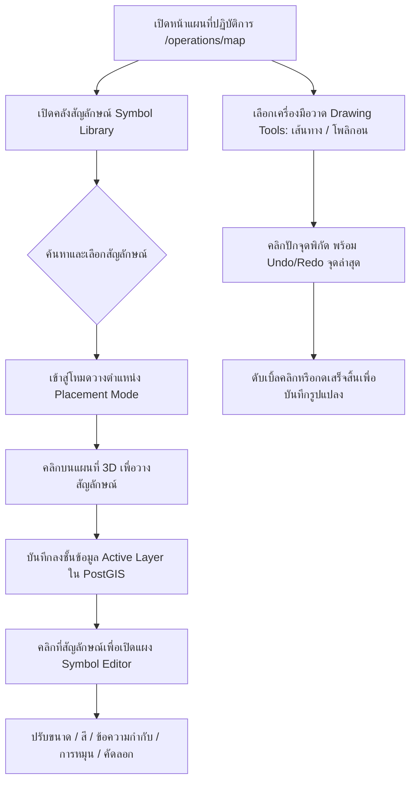

# 19. คลังสัญลักษณ์ทางยุทธวิธีและเครื่องมือวาดแผนที่ (Map Symbol Library & Drawing Tools)

เอกสารนี้อธิบายขั้นตอนการใช้งานระบบ **คลังสัญลักษณ์ทางยุทธวิธี (Map Symbol Library)** ที่ได้รับแรงบันดาลใจจาก workflow ของ map.army, เครื่องมือวาดเวกเตอร์แผนที่ (General Drawing Tools), แผงแก้ไขคุณสมบัติรูปแปลง (Symbol & Feature Editor), การจัดลำดับและบริหารชั้นข้อมูล (Layer Management), และการนำเข้า/ส่งออกไฟล์มาตรฐาน GeoJSON ในระบบ **GeoMonitor 3D**

---

## 1. วัตถุประสงค์
1. ให้บริการคลังสัญลักษณ์ทางยุทธการ กู้ภัย และแผนที่สำรวจแบบเวกเตอร์ (Vector-based Symbol Catalog) ที่ค้นหาได้ตามหมวดหมู่ ไม่ใช้เพียงหมุดวงกลมพื้นฐาน
2. รองรับกระบวนการวางตำแหน่งสัญลักษณ์ลงบนแผนที่ CesiumJS 3D/2D อย่างแม่นยำ พร้อมระบบคำนวณพิกัดภูมิศาสตร์ WGS84 (EPSG:4326)
3. สนับสนุนเครื่องมือวาดรูปทรงเรขาคณิต (Point, Polyline, Polygon, Rectangle, Circle, Text Annotation) พร้อมระบบ Undo / Redo จุดพิกัด
4. แก้ไข ปรับขนาด สี ทิศทางการหมุน (Rotation) ความโปร่งแสง ป้ายกำกับข้อความ (Label) คัดลอก (Duplicate) และย้ายชั้นข้อมูลของวัตถุได้อย่างอิสระ
5. จัดการชั้นข้อมูลอย่างสมบูรณ์: กำหนดชั้นข้อมูลที่กำลังใช้งาน (Active Layer), จัดลำดับความสำคัญ (Layer Reordering), ปรับความโปร่งแสง, กำหนดสิทธิ์แบบอ่านอย่างเดียว (Read-Only Guard)
6. บันทึกรูปแปลงลงในฐานข้อมูล PostgreSQL + PostGIS ด้วย GIST Spatial Index และส่งออก/นำเข้าข้อมูล GeoJSON โดยเก็บรักษาข้อมูลคุณลักษณะรูปแบบ (Style Extension) ไว้อย่างครบถ้วน
7. ป้องกันความปลอดภัยของระบบด้วยการคัดกรองและปฏิเสธไฟล์ SVG ที่มีสคริปต์หรือแท็กอันตราย (XSS Sanitization)

---

## 2. สิ่งที่ต้องเตรียม
1. บัญชีผู้ใช้งานระบบที่มีสิทธิ์ระดับ `admin`, `project_manager`, หรือ `analyst` (ระดับ `viewer` สามารถดูสัญลักษณ์และรูปแปลงบนแผนที่ได้ แต่ไม่สามารถแก้ไขหรือวางสัญลักษณ์ใหม่ได้)
2. โครงการ (Project) และชั้นข้อมูล (Layer) ที่สร้างไว้แล้วในระบบ
3. เว็บบราวเซอร์ที่รองรับ WebGL (Google Chrome, Microsoft Edge, Safari หรือ Firefox)

---

## 3. สถาปัตยกรรมและหมวดหมู่สัญลักษณ์เริ่มต้น (Initial Categories)

ระบบมีสัญลักษณ์มาตรฐานเวกเตอร์ให้ใช้งานเริ่มต้น 10 หมวดหมู่:
| รหัสหมวดหมู่ (Key) | ชื่อหมวดหมู่ภาษาไทย / อังกฤษ | ตัวอย่างสัญลักษณ์ |
|---|---|---|
| `general_locations` | General Locations (ตำแหน่งทั่วไป) | หมุดระบุพิกัด, ทิศทางนำร่อง, กากบาทเล็งเป้า, ธงชัย, เข็มทิศ |
| `offices_facilities` | Offices and Facilities (กองบัญชาการและอาคาร) | กองบัญชาการใหญ่, ศูนย์สั่งการส่วนหน้า, คลังยุทธบริภัณฑ์, ป้อมตรวจการ |
| `people_teams` | People and Teams (กำลังพลและชุดปฏิบัติการ) | ชุดปฏิบัติการ, เจ้าหน้าที่พร้อมรบ, ชุดเสริมกำลัง, หน่วยคุ้มกันพิเศษ |
| `vehicles_equipment` | Vehicles and Equipment (ยานพาหนะและยุทโธปกรณ์) | รถบรรทุกยุทธวิธี, รถสายตรวจ, อากาศยาน/โดรน, เรือลาดตระเวน |
| `medical_emergency` | Medical and Emergency Services (หน่วยแพทย์และกู้ชีพ) | ศูนย์ปฐมพยาบาล, รถพยาบาลฉุกเฉิน, เครื่องช่วยฟื้นคืนชีพ, จุดเตือนภัย |
| `infrastructure` | Infrastructure (โครงสร้างพื้นฐาน) | เสาส่งสัญญาณสื่อสาร, สถานีพลังงาน, ศูนย์ข้อมูลดาต้าเซ็นเตอร์, สถานีเชื่อมต่อเครือข่าย |
| `environmental_monitoring` | Environmental Monitoring (เฝ้าระวังสิ่งแวดล้อม) | แนวป่าอนุรักษ์, จุดตรวจวัดภูมิประเทศ, สถานีเฝ้าระวังน้ำท่วม, จุดตรวจจับไฟป่า |
| `drone_survey` | Drone Survey Locations (จุดสำรวจและขึ้นบินโดรน) | จุดขึ้น-ลงโดรน (Drone Launch/Landing), จุดเฝ้าระวังทางอากาศ, พิกัดตรวจจับ |
| `general_graphics` | General Map Graphics (รูปทรงกราฟิกแผนที่) | วงกลมมาร์กเกอร์, กรอบสี่เหลี่ยม, สามเหลี่ยมเตือน, ลูกศรบอกทิศทาง |
| `custom_symbols` | Custom Symbols (สัญลักษณ์กำหนดเอง) | สัญลักษณ์เฉพาะหน่วยงานที่อัปโหลดผ่านไฟล์ SVG หรือกำหนดคีย์ไอคอน |

---

## 4. ขั้นตอนการใช้งานทีละข้อ (Step-by-Step Walkthrough)



### 4.1 การค้นหาและวางสัญลักษณ์จากคลัง (Symbol Library & Placement)
1. เข้าไปที่เมนู **"แผนที่ปฏิบัติการ"** (`/operations/map`)
2. คลิกปุ่ม **"คลังสัญลักษณ์" (Symbol Library)** หรือไอคอนดาวประกายพรึกบนแถบเครื่องมือวาด
3. หน้าต่างคลังสัญลักษณ์จะปรากฏขึ้น ผู้ใช้สามารถ:
   - **ค้นหาตามคำสำคัญ (Search)**: พิมพ์คำค้น เช่น "บก.", "พยาบาล", "โดรน", "ยานพาหนะ"
   - **กรองตามหมวดหมู่ (Category Filter)**: เลือกหมวดหมู่ที่ต้องการจากเมนู Dropdown
   - **สลับมุมมอง (Grid / List View)**: เลือกดูแบบตารางไอคอนพรีวิวหรือรายการแบบละเอียด
   - **บันทึกรายการโปรด (Favorites)**: คลิกไอคอนรูปดาว ⭐ ที่มุมของสัญลักษณ์ เพื่อเก็บไว้ในแท็บ "รายการโปรด"
   - **ดูประวัติใช้ล่าสุด (Recent Symbols)**: คลิกแท็บ "ใช้ล่าสุด" เพื่อเลือกใช้สัญลักษณ์ที่เพิ่งนำมาวางอย่างรวดเร็ว
4. **คลิกเลือกสัญลักษณ์ที่ต้องการ**:
   - ระบบจะเข้าสู่ **โหมดวางตำแหน่ง (Placement Mode)** ตัวชี้เมาส์จะเปลี่ยนเป็นกากบาทเล็งเป้า (Crosshair)
   - แถบสถานะด้านบนจะแสดงคำแนะนำ: *"คลิกบนแผนที่เพื่อวางสัญลักษณ์... (กด Esc เพื่อยกเลิก)"*
5. **คลิกตำแหน่งบนแผนที่ 3 มิติ**:
   - ระบบจะแปลงตำแหน่งบนหน้าจอ (Screen Space) ให้กลายเป็นพิกัดภูมิศาสตร์ละติจูด/ลองจิจูด WGS84
   - บันทึกสัญลักษณ์ลงใน **ชั้นข้อมูลที่เลือกใช้งานอยู่ (Active Layer)** โดยอัตโนมัติ
   - สัญลักษณ์จะปรากฏบนแผนที่ทันที พร้อมไอคอนเวกเตอร์ ป้ายชื่อ และสีประจำหมวดหมู่

---

### 4.2 การแก้ไขและปรับแต่งคุณสมบัติสัญลักษณ์ (Symbol Editor)
1. นำเมาส์ไปคลิกที่สัญลักษณ์หรือรูปแปลงใดๆ บนแผนที่
2. แผงควบคุม **"แก้ไขวัตถุแผนที่" (Feature Editor Panel)** จะเปิดขึ้นที่มุมขวาบนของจอภาพ
3. สามารถปรับแต่งคุณสมบัติต่างๆ ได้ทันที:
   - **ชื่อและคำอธิบาย**: แก้ไขชื่อวัตถุและบันทึกรายละเอียดงาน
   - **ชั้นข้อมูล (Layer)**: สามารถเลือกย้ายวัตถุข้ามไปยังชั้นข้อมูลอื่นได้
   - **สี (Color)**: เลือกจากชุดสีทางยุทธวิธีสำเร็จรูป (Cyan, Red, Amber, Emerald, Purple ฯลฯ) หรือพิมพ์ค่า Hex Code
   - **ขนาดไอคอน (Icon Size)**: ปรับเลื่อนแถบ Slider ได้ตั้งแต่ 12px ถึง 64px
   - **ทิศทางการหมุน (Rotation)**: ปรับมุมองศาการหันได้ตั้งแต่ 0° ถึง 360° (เช่น หันลูกศรหรือยานพาหนะไปตามทิศทางการเคลื่อนที่)
   - **ความโปร่งแสง (Opacity)**: ปรับความโปร่งใสของสัญลักษณ์ได้ตั้งแต่ 10% ถึง 100%
   - **ป้ายข้อความกำกับ (Label)**: เปิด/ปิดการแสดงข้อความบนแผนที่ ปรับข้อความ และขนาดฟอนต์ (9px - 24px)
   - **คุณสมบัติเส้นและพื้นที่ (Stroke & Fill)**: สำหรับเส้นทางและโพลิกอน สามารถปรับความหนาเส้น (Stroke Width) และความทึบของสีพื้น (Fill Opacity) ได้
4. **ปุ่มคำสั่งการจัดการ**:
   - **ปรับใช้ (Apply)**: บันทึกการเปลี่ยนแปลงขึ้นสู่ระบบ API และอัปเดตการแสดงผลบนแผนที่ทันที
   - **คัดลอกวัตถุ (Duplicate)**: สร้างสัญลักษณ์สำเนาโดยออฟเซ็ตตำแหน่งเล็กน้อย สะดวกต่อการจัดวางกำลังพลที่มีคุณสมบัติใกล้เคียงกัน
   - **ลบวัตถุ (Delete)**: ลบสัญลักษณ์ออกจากแผนที่พร้อมกล่องข้อความยืนยัน

---

### 4.3 การใช้เครื่องมือวาดเวกเตอร์ทั่วไป (General Drawing Tools)
บนแถบเครื่องมือมุมซ้ายบนของแผนที่ ผู้ใช้สามารถเลือกเครื่องมือวาดต่างๆ ได้:
1. **จุดมาร์กเกอร์ (Point Marker)**: คลิกหนึ่งครั้งเพื่อวางหมุดพิกัด
2. **เส้นทาง / เส้นต่อจุด (Polyline)**:
   - คลิกบนแผนที่ทีละจุดเพื่อต่อเส้นทาง แถบสถานะจะนับจำนวนจุดพิกัดที่บันทึกแล้ว
   - สามารถกดปุ่ม **เลิกทำ (Undo)** เพื่อย้อนจุดพิกัดล่าสุด หรือกด **ทำซ้ำ (Redo)** ได้
   - ดับเบิ้ลคลิกซ้าย หรือกดปุ่ม **"เสร็จสิ้น"** เพื่อจบการวาดเส้นทาง
3. **รูปหลายเหลี่ยม / ขอบเขตพื้นที่ (Polygon)**:
   - คลิกปักจุดรอบขอบเขต (ต้องมีอย่างน้อย 3 จุด)
   - ดับเบิ้ลคลิกซ้าย หรือกดปุ่ม **"เสร็จสิ้น"** เพื่อปิดล้อมขอบเขตพื้นที่เป็นโพลิกอน
4. **สี่เหลี่ยมผืนผ้า (Rectangle)**:
   - คลิกจุดมุมที่ 1 และคลิกจุดมุมทแยงมุมที่ 2 เพื่อสร้างกรอบสี่เหลี่ยม
5. **วงกลม / รัศมีปฏิบัติการ (Circle)**:
   - คลิกจุดที่ 1 เพื่อกำหนดจุดศูนย์กลาง และคลิกจุดที่ 2 เพื่อกำหนดระยะรัศมี
6. **ข้อความกำกับแผนที่ (Text Annotation)**:
   - คลิกบนแผนที่เพื่อกรอกข้อความที่ต้องการแสดงเป็นป้ายบนภูมิประเทศ 3 มิติ

---

### 4.4 การบริหารจัดการชั้นข้อมูล (Layer Management)
ในแถบด้านซ้าย คลิกแท็บ **"ชั้นข้อมูล" (Layers)**:
1. **การเลือกชั้นข้อมูลที่กำลังใช้งาน (Active Layer)**:
   - คลิกที่ปุ่มวงกลมหน้าชื่อชั้นข้อมูล เพื่อกำหนดให้เป็น Active Layer
   - ทุกสัญลักษณ์และการวาดใหม่จะถูกบันทึกลงในชั้นข้อมูลนี้โดยอัตโนมัติ
2. **การจัดลำดับชั้นข้อมูล (Layer Reordering)**:
   - คลิกปุ่ม **ลูกศรขึ้น (Arrow Up)** หรือ **ลูกศรลง (Arrow Down)** บนชั้นข้อมูล เพื่อสลับลำดับการแสดงผล (Z-Index / Render Order)
   - ระบบจะบันทึกลำดับ `order_index` ลงในฐานข้อมูลทันที
3. **การเปิด/ปิดการมองเห็นและปรับความโปร่งแสง**:
   - คลิกไอคอน **ดวงตา (Eye / EyeOff)** เพื่อซ่อนหรือแสดงรูปแปลงทั้งหมดในชั้นข้อมูลนั้น
   - เลื่อนแถบ Slider **ความโปร่งแสง (Opacity)** เพื่อปรับความเข้มของเลเยอร์ (เช่น เลเยอร์ขอบเขตอันตรายปรับให้โปร่งแสง 30%)
4. **การล็อกสิทธิ์แบบอ่านอย่างเดียว (Read-Only Guard)**:
   - ชั้นข้อมูลที่มีไอคอนกุญแจ 🔒 จะป้องกันการแก้ไข วาดเพิ่ม หรือลบวัตถุในชั้นข้อมูลนั้นโดยเด็ดขาด
5. **การเปลี่ยนชื่อและการลบ**:
   - คลิกไอคอน **แก้ไข (Edit)** เพื่อเปลี่ยนชื่อชั้นข้อมูล
   - คลิกไอคอน **ถังขยะ (Trash)** เพื่อลบชั้นข้อมูลพร้อมรูปแปลงทั้งหมด (มีกล่องข้อความยืนยันก่อนลบ)

---

### 4.5 การนำเข้าและส่งออกข้อมูล GeoJSON (Import & Export)
1. **การส่งออก (Export GeoJSON)**:
   - ในชั้นข้อมูลที่ต้องการ ให้คลิกไอคอน **ดาวน์โหลด (Download)**
   - ระบบจะสร้างไฟล์ `<layer_name>_export.geojson` โดยบันทึกโครงสร้าง WGS84 พร้อมคุณลักษณะการจัดสไตล์เฉพาะ (เช่น สี, ขนาด, การหมุน, ข้อความป้าย) ไว้ในส่วนขยาย `properties.style`
2. **การนำเข้า (Import GeoJSON)**:
   - คลิกไอคอน **อัปโหลด (Upload)** ในชั้นข้อมูลที่ต้องการนำเข้า
   - เลือกไฟล์ `.geojson` หรือ `.json`
   - ระบบจะทำการตรวจสอบ:
     - ความถูกต้องของโครงสร้าง `FeatureCollection`
     - ระบบพิกัดอ้างอิง WGS84
     - แสดงกล่องสรุปจำนวนจุด (Points), เส้น (Lines), และพื้นที่ (Polygons) ก่อนยืนยัน
   - กดปุ่ม **"ยืนยันนำเข้าข้อมูล"** วัตถุทั้งหมดจะถูกบันทึกลงในฐานข้อมูล PostGIS และแสดงผลบนแผนที่ทันที

---

### 4.6 การสร้างสัญลักษณ์กำหนดเองอย่างปลอดภัย (Custom Symbol & Safe SVG)
1. เปิดหน้าต่างคลังสัญลักษณ์ แล้วคลิกแท็บ **"สร้างสัญลักษณ์กำหนดเอง"**
2. กรอกชื่อสัญลักษณ์, หมวดหมู่, สีเริ่มต้น, ขนาด, และแท็กค้นหา
3. **การอัปโหลดไฟล์ SVG**:
   - สามารถเลือกไฟล์เวกเตอร์ `.svg` ของหน่วยงาน
   - **ระบบความปลอดภัยเข้มงวด**: ระบบจะปฏิเสธไฟล์ที่มีแท็ก `<script>`, รหัส JavaScript, หรือ Event Handlers (เช่น `onload`, `onclick`) ทันที เพื่อป้องกันช่องโหว่ความปลอดภัยแบบ Stored XSS

---

## 5. ตัวอย่างคำสั่ง cURL สำหรับทดสอบ API

### 5.1 ค้นหาสัญลักษณ์ในคลัง
```bash
curl -X GET "http://localhost:4000/api/v1/symbols?category=medical_emergency&search=พยาบาล" \
  -H "Authorization: Bearer <TOKEN>"
```

### 5.2 วางสัญลักษณ์ใหม่ลงในชั้นข้อมูล
```bash
curl -X POST "http://localhost:4000/api/v1/layers/<LAYER_ID>/features" \
  -H "Authorization: Bearer <TOKEN>" \
  -H "Content-Type: application/json" \
  -d '{
    "featureType": "Point",
    "name": "จุดพยาบาลส่วนหน้า",
    "symbolId": "<SYMBOL_ID>",
    "geometry": {
      "type": "Point",
      "coordinates": [101.1455, 12.6788]
    },
    "style": {
      "color": "#ef4444",
      "size": 32,
      "rotation": 0,
      "opacity": 1.0,
      "labelText": "ปฐมพยาบาล 01",
      "showLabel": true
    }
  }'
```

### 5.3 จัดลำดับชั้นข้อมูล (Layer Reordering)
```bash
curl -X POST "http://localhost:4000/api/v1/layers/reorder" \
  -H "Authorization: Bearer <TOKEN>" \
  -H "Content-Type: application/json" \
  -d '{
    "items": [
      { "id": "<LAYER_ID_1>", "orderIndex": 0 },
      { "id": "<LAYER_ID_2>", "orderIndex": 1 }
    ]
  }'
```

### 5.4 คัดลอกวัตถุสัญลักษณ์ (Duplicate)
```bash
curl -X POST "http://localhost:4000/api/v1/features/<FEATURE_ID>/duplicate" \
  -H "Authorization: Bearer <TOKEN>"
```

---

## 6. คำแนะนำและข้อควรระวัง
1. **การคลิกนอกผิวโลก 3D**: หากผู้ใช้คลิกบนท้องฟ้าหรืออวกาศ ระบบ CesiumJS จะตรวจสอบและข้ามการสร้างพิกัดโดยอัตโนมัติ เพื่อป้องกันการบันทึกพิกัดที่เป็น `NaN` หรือไม่ถูกต้อง
2. **การวาดขอบเขตพื้นที่ (Polygon)**: การวาดขอบเขตต้องมีจุดพิกัดอย่างน้อย 3 จุดขึ้นไป หากปักจุดไม่ครบ ปุ่ม "เสร็จสิ้น" จะถูกระงับการทำงาน
3. **การส่งออกและนำเข้าข้ามโปรแกรม GIS**: ไฟล์ GeoJSON ที่ส่งออกจากระบบเป็นไปตามมาตรฐาน RFC 7946 สามารถนำไปเปิดใน QGIS, ArcGIS หรือ Google Earth ได้อย่างสมบูรณ์ สำหรับการแสดงผลสัญลักษณ์แบบเฉพาะเจาะจง ข้อมูลสไตล์จะถูกบรรจุอยู่ในคีย์ `properties.style`
